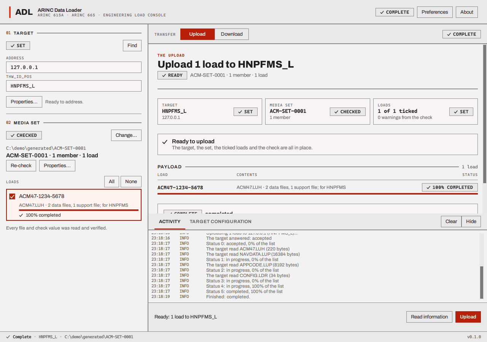

# ARINC Data Loader

ARINC Data Loader implements two standards for loading software into aircraft equipment. ARINC 665 describes how loadable software is packaged into a *media set*. ARINC 615A describes how a data loader moves a load to a target, and fetches files from it, over an Ethernet network. The project is three programs and the libraries under them, for Windows, Linux and macOS.

**Status.** Version 0.1.1 is a preliminary release. The programs work together on one machine. Nothing has been checked against a real target, a real loader or another tool's media sets. [What has been checked](status.md) says what has been and what has not.
{ .icl-callout }

| Program | What it does |
| --- | --- |
| **ARINC Data Loader** | Finds a target on the network, reads what it holds, sends a load to it (*upload*) and fetches files from it (*download*) |
| **ARINC Media Set Generator** | Turns files from your disk into a media set, the folder layout the loader reads, and checks what it wrote |
| **ARINC Mock Target** | Stands in for a piece of equipment, so you can try the loader and test it without hardware |
| **The libraries** | ARINC 665 media sets, the ARINC 615A codec and state machines, and the platform layer under them, for programs of your own |

## Get it

Each release on GitHub has a portable package for Windows, Linux and macOS, with checksums, signatures and a bill of materials. There is no installer. [Releases](https://github.com/iainchesworthlabs/arinc-data-loader/releases) lists them, and [Verifying a release](verifying-releases.md) says how to check a download. The programs can also be built from source ([Building](building.md)).

## Where to start

| I want to | Read |
| --- | --- |
| Try it on one computer, with no hardware | [The demonstration](user-guide/demonstration.md) |
| Make a media set from my files | [Make a media set](user-guide/make-a-media-set.md) |
| Load or download from a target | [The loader, screen by screen](user-guide/loader.md) |
| Know what a word means | [Glossary](glossary.md) |
| Use the libraries in my own program | [Using the libraries](libraries.md) |
| Build, test or change the software | [For programmers](developers.md) |

The whole guide starts at [the user's guide](user-guide/index.md).

ARINC Data Loader is free software under the GNU General Public License, version 3 or later. It comes with no warranty. It is made by Iain Chesworth Labs.
