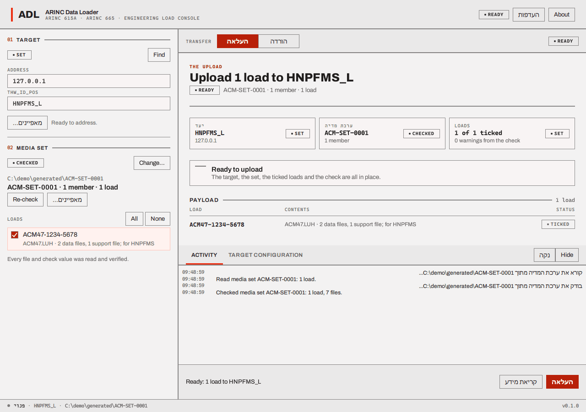
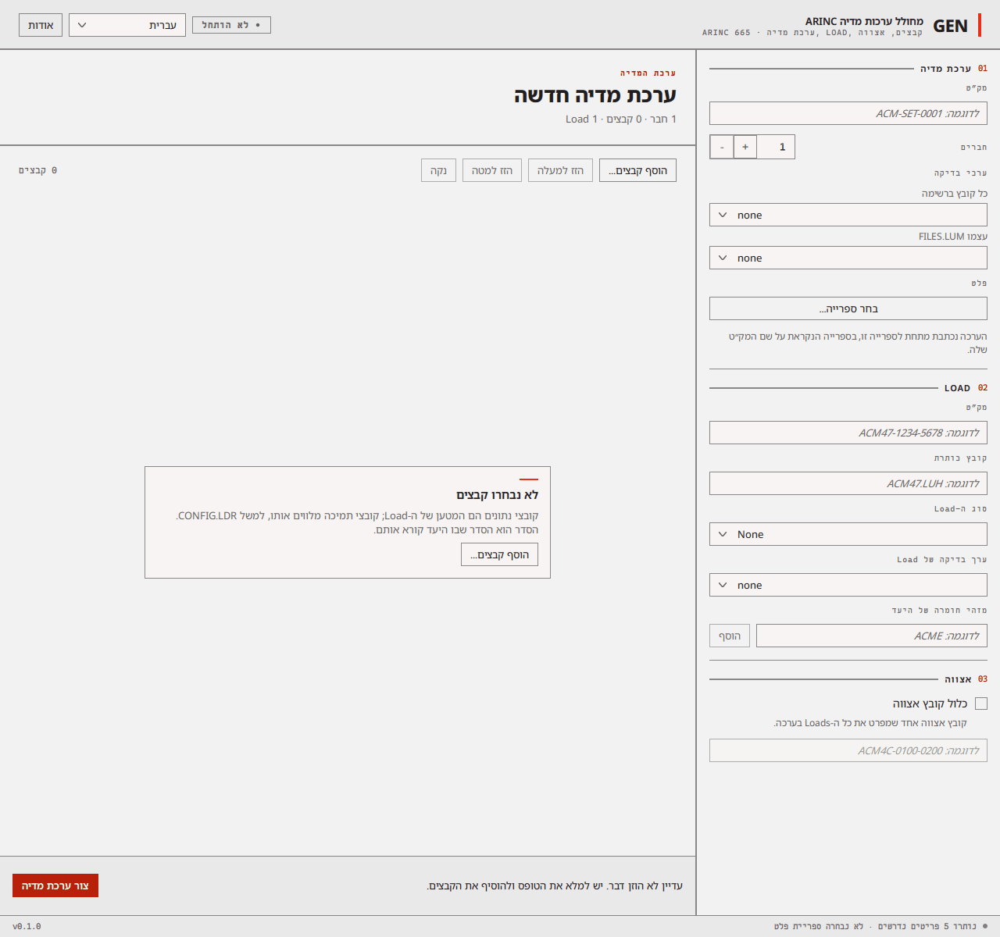
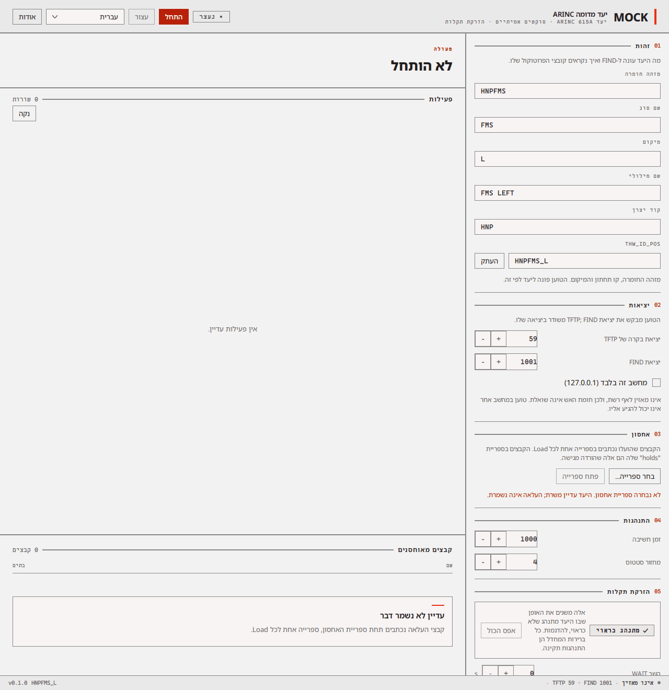
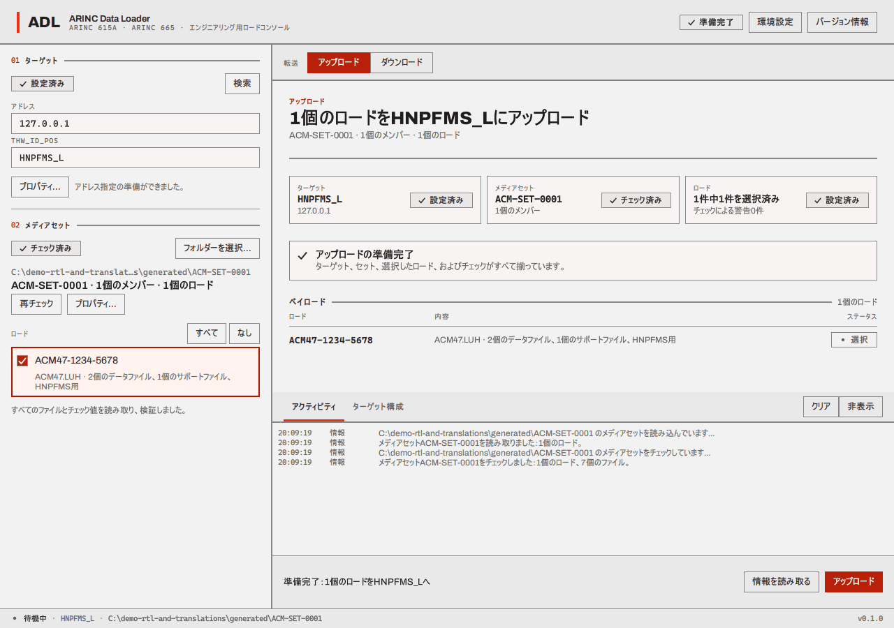
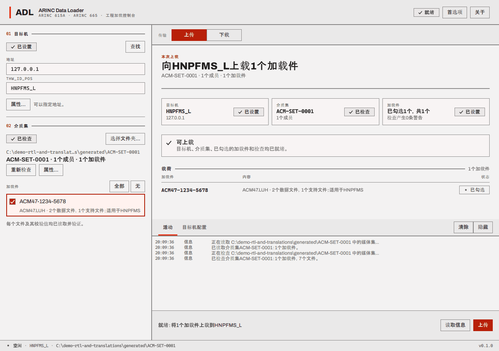

# Translations and right-to-left layout

How the three programs are translated, how a language is switched, how the window mirrors for the
right-to-left scripts, and what to do when you add or change text. The user's view is in
[Languages and colour](user-guide/languages-and-colour.md).

## What is there

The loader, the generator and the mock target all have a language picker (the loader's is in
Preferences, the other two's in the header, beside About) and offer the same eight languages:
English (the source), French, Spanish, German, Yiddish, Hebrew, Simplified Chinese and Japanese.
The choice is kept per program (QSettings, `language/code`), applies to the open window at once
and, on a first start, follows the system's language when it is one of these.

**The seven translations are machine-drafted first versions.** They were written for this project
without a translator; no speaker of French, Spanish, German, Yiddish, Hebrew, Chinese or Japanese has
read them, and the Yiddish and the Hebrew, which have no established avionics vocabulary, are the
ones most in need of an eye. Every message has a translation (a test holds it to that), which is a
smaller claim than that every translation is right. The terms to look at first are in
[the notes for a reviewer](#for-a-reviewer).

## How it is built

| Catalogue | Source of the strings | File |
| --- | --- | --- |
| Shared interface | `libs/ui/qml` (dialogs, log view, check tile, language picker, licences) | `libs/ui/translations/adl_ui_<code>.ts` |
| Loader | `apps/app/qml`, `apps/app/core` | `apps/app/translations/adl_app_<code>.ts` |
| Generator | `apps/media_gen/qml`, `apps/media_gen/core` | `apps/media_gen/translations/adl_media_gen_<code>.ts` |
| Mock target | `apps/mock_target/qml`, `apps/mock_target/core` (its model; the 615A engine's activity lines are not translated) | `apps/mock_target/translations/adl_mock_target_<code>.ts` |

Each family has one file per language (`de es fr he ja yi zh`) and an English file, `_en.ts`, which
holds only the plural forms (see below). `cmake/AdlUi.cmake` (`adl_add_app_translations`,
`adl_generate_ui_translations`) runs lupdate with `-no-obsolete`, compiles the files with lrelease
and embeds the `.qm` under `:/i18n`; the shared interface's are embedded in each program by
`adl_add_ui_support`. `adl::ui::LanguageManager` (`libs/ui/language_manager.cpp`, shared by the three
programs) installs Qt's own catalogue, the shared one and the program's for the language, sets the
application's layout direction and typeface, and calls `QQmlEngine::retranslate()`.

### Counts

A count is a plural message: `qsTr("%n load(s)", "", n)` in QML, `Message::translated(&Class::tr,
QT_TR_N_NOOP("%n load(s)"), {}, n)` in C++ (see below). Each language has the forms Qt's rules give
it (two for French, Spanish, German, Hebrew and Yiddish; one for Chinese and Japanese). English has
no catalogue for ordinary strings but needs one for these, because the source holds only the "(s)"
form: `_en.ts` is lupdate's output through `lconvert -pluralonly`, installed like the others.

A sentence can carry only one `%n`. "Checked media set %1: 2 loads, 3 files" is therefore a sentence
with two arguments, each of which is a plural phrase of its own.

### Text the engine says

What the engine and the models say is made on the engine's thread and shown for as long as it is on
screen, so a `QString` made with `tr()` at that moment would stay in the language of that moment.
`adl::ui::Message` (`libs/ui/include/adl/ui/message.hpp`) keeps the untranslated source, the count and
the arguments and is translated each time it is read: the log lines, how a job ended (`outcome`,
`detail`, `hint`), the failure on show, the check's detail, the loads' status and the generator's
result are Messages, and `retranslate()` on the models (connected to
`LanguageManager::currentLanguageChanged` in each `main()`) makes the window read them again.
`adl::app::Wording` gives words to the 615A library's enumerations (outcomes, statuses, transfer
outcomes, notices); the library keeps naming them in English for logs and tests.

What is **not** translated, and so stays English in every language: the findings of the ARINC 665
library (`clause: message`) and the names of its and the media tree's errors, the platform's error
codes in parentheses, what the target itself sends (names, descriptions, its status words in a
description), the standard's check-value algorithm names, the log lines of the mock target's 615A
engine, the `HostFactory`'s failure text (made when the job starts), and the two Qt-owned native
dialogs (the file and folder pickers follow the system's language).

### Adding or changing a string

1. Write it with `qsTr()` (QML) or, in C++, with `tr()` of a class with `Q_OBJECT` or
   `Q_DECLARE_TR_FUNCTIONS`; text that outlives the moment is a `Message`. A count is a `%n`
   message with "(s)" for the plural, with the count given. Do not build a plural with
   `n == 1 ? a : b`: two plain messages are translated on their own and neither follows the plural
   forms of the language. The headline of the Upload view is one such message,
   `qsTr("Upload %n load(s) to %1", "", n)`.
2. `cmake --build <dir> --target update_translations` extracts every catalogue. A new or reworded
   string arrives `unfinished`.
3. Give it its translation in the seven languages (and its two forms in `_en.ts` if it is plural),
   and take `unfinished` off. `tests/unit/translations_test.cpp` fails until every message is
   finished and well-formed; the `translations.current.*` tests fail when a catalogue no longer
   matches the sources (lupdate is run over a copy and compared, ignoring `<location>` lines).
4. Commit the `.ts` files.

A new language is a `.ts` file in each of the four directories (create it with lupdate, and check
that its `language="..."` attribute is the bare code: lupdate takes it from the file name, and
`adl_ui_fr.ts` came out as `ui_fr`), the code in `ADL_TRANSLATED_LANGUAGES` (`cmake/AdlUi.cmake`),
its line in the table in `libs/ui/language_manager.cpp` (with the typeface it needs), the list in
`tests/unit/translations_test.cpp`, and the code lists in `apps/app/tests/qml_test.cpp`. That test names
the codes in two places: the checks of the layout direction Qt gives each code (a list of the
left-to-right codes, and a separate check for Hebrew and Yiddish), and the loop over the seven
languages that installs each catalogue in the running window and checks the text, the layout
direction and the typeface. The generator's and the mock target's window tests loop over Hebrew and
Yiddish only, so a new left-to-right language needs no change there.

## Right to left

Hebrew and Yiddish read right to left. `QGuiApplication::setLayoutDirection` alone mirrors nothing in
Qt Quick, so each window root sets

```qml
LayoutMirroring.enabled: Qt.application.layoutDirection === Qt.RightToLeft
LayoutMirroring.childrenInherit: true
```

and everything below it, dialogs and popups included (they hang from the window's overlay), follows:
the rail moves to the right edge, a row's items and a layout's columns swap, the header's actions
swap, a segmented control's segments swap, `Row`/`RowLayout` mirror, `anchors.left/right` and their
margins mirror, and `Layout.leftMargin` is the margin on the start edge (the layouts mirror it with
the item: a 26 px indent under a check box is on the right in Hebrew, with no code of ours).

What does not mirror by itself is a position written as an `x`, a `leftPadding`/`rightPadding`
or an indicator placed from `control.width`. Those are written from the start or end edge:
`TaskProgress` (the bar fills from the start; its width follows `position`, not `visualPosition`,
which a mirrored bar already flips), `AppCheckBox`'s note, `AppComboBox`'s chevron and padding,
`AppSpinBox`'s steppers and padding, `AppTextField`'s unit and padding. `SegmentedControl` swaps
Left and Right with `mirrored`, so the arrow that goes to the neighbour on the right still does.
When you add a control, place things with anchors or layouts, or test `control.mirrored` (or
`LayoutMirroring.enabled` on a plain item) for the one `x` you cannot avoid.

`tests/ui/qml/tst_right_to_left.qml` switches the language through the real manager and checks, on
the real `Main.qml`: the rail on the right, the header's actions and the segments swapped, a check
box's box on the right of its label with the detail line indented from the right, a spin box's
steppers on the left, a progress bar filling from the right (10 % is 10 %, not 90 %), and the window
coming back when English is chosen. The generator's and the mock target's window tests check that
their header (the picker in it) mirrors. `app.qml` checks that Qt's own locale data calls exactly
Hebrew and Yiddish right to left.







(These pictures are of the real programs, taken by the capture script
`tools/docs/capture_screenshots.ps1` with the language set to Hebrew; see
[the screenshots](screenshots.md). The offscreen window tests, `adl_app_qml_test`,
`adl_gen_qml_test` and `adl_mock_qml_test`, can save a right-to-left picture of their own when they
are given a picture path, but those pictures are not the ones shown here.)

## Typefaces

Archivo has no Hebrew letters and no Chinese or Japanese characters.

- **Hebrew and Yiddish** are set in **Noto Sans Hebrew** (SIL OFL 1.1), bundled: four static
  instances (Regular, Medium, SemiBold, ExtraBold, in `libs/ui/fonts`) cut from the Noto Project's
  variable font, registered by `register_fonts()`. `LanguageManager` makes it the application's
  typeface for those two languages and `Theme.headingFamily` follows the layout direction. Its
  licence and copyright are in `libs/ui/fonts/NotoSansHebrew-OFL.txt`, and in About > Licences
  (`notices/fragments/fonts.txt`).
- **Chinese and Japanese** are drawn in the system's own CJK fonts (Archivo stays for the Latin
  letters). No CJK face is bundled: one is several megabytes per script and the desktops the
  programs run on ship them. A system without a CJK font shows empty boxes for those two languages
  (a minimal Linux install or container; install a font such as Noto Sans CJK). On a real Windows
  desktop both are drawn by the system's fallback fonts (the pictures below are in the light
  scheme; there is no dark picture of either), though a line may mix glyph weights where the
  fallback hops between fonts. **The offscreen window tests
  cannot draw them**: Qt's offscreen platform has no fallback fonts on Windows, so a picture made
  there shows boxes for Chinese and Japanese (the tests check the text, not the glyphs; the pictures
  below were made on the real Windows platform).





## For a reviewer

The terms chosen for each language are listed in
[the translation glossaries](translation-glossaries.md), by language. The domain words (load, media
set, target, upload, download, abort, check value) are what a speaker will recognise or not, so read
them first.

Worth reading next: the small status chips (SET, FOUND, SELECTED, ...), which are single words
whose grammatical gender depends on what they label, the fault-injection labels of the mock target
and the sentences with several counts. A review is a pull request that
edits the `.ts` file of its language (and, where a term changes, every message that uses it): the
tests above keep the placeholders, the plural forms and the identifiers right whatever is changed.
