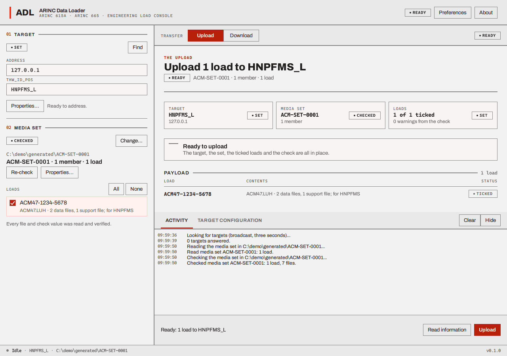
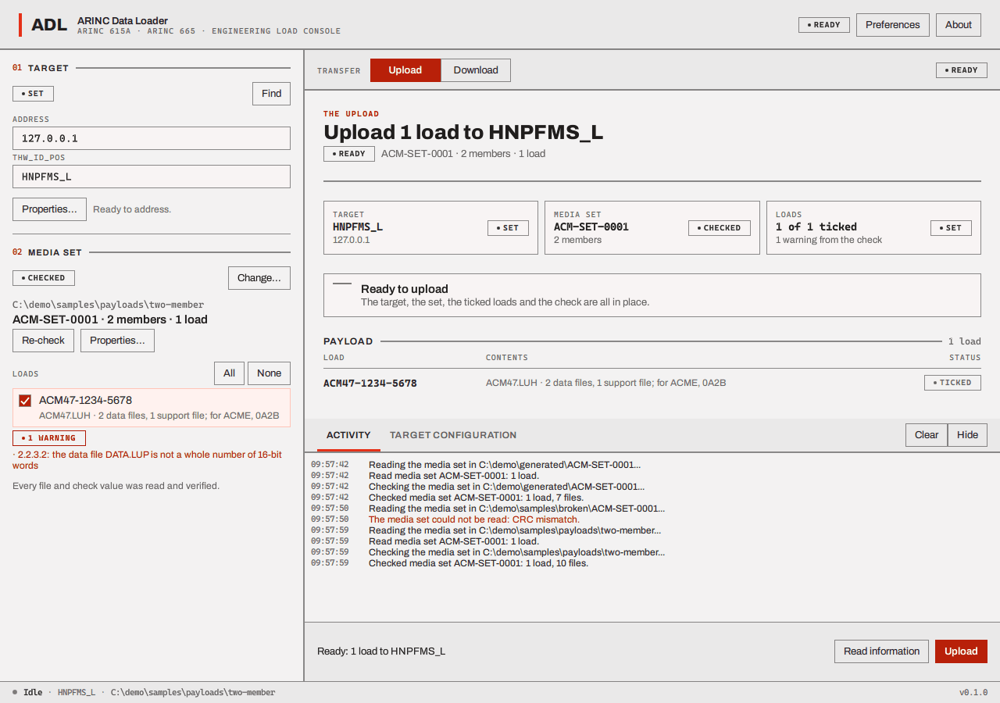

# Choose and check a media set

A media set, to the loader, is a **folder that holds one folder per member** (`member_001`, ...):
exactly what the generator writes and what `adl_write_payloads` writes for its samples. If you
choose the wrong level (a member folder, or a folder above the set) the loader says it cannot read it.

Press **Choose...** in the **02 Media set** block, pick the folder, and the loader **reads and
checks** it straight away (unless you turned that off in [Preferences](preferences.md)). Reading
**is** checking: every file is opened, its length and its check values are verified, the three
list files of every member are compared with each other and with what is on the disk. The chip goes
**CHECKING**, then **CHECKED** or **INVALID**.

## A set that passes

The rail shows the set's part number, the number of members and loads, "Every file and check value
was read and verified.", and each load with a check box. Tick the loads you want to upload
(**All** ticks every one).

**Warnings.** Findings are places where the set differs from what the standard *recommends* but
is still readable: for example a data file whose size is not a whole number of 16-bit words. They
are listed under a **WARNING** chip (the first three; **Show all warnings** shows the rest) and in
the set's properties. They do not stop an upload.

## A set that fails

If a file is missing, has the wrong length, or does not match its check value, or a list file is
damaged, the chip says **INVALID**, the rail and the Upload view show the reason (for example "CRC
mismatch" for a data file with a changed byte), a dialog opens once with that reason and the hint
"Choose the directory the media set was written to, and make sure every file of the set is still
in it", and **Upload stays dimmed**: nothing can be sent from a set that does not check.

Fix the set (or choose another) and press **Re-check**.

## Re-checking

**Re-check** reads the whole set again, so changes made on disk after it was first read are
caught. The loader does not notice changes by itself: a file changed or deleted *after* the check
and before it is sent will arrive as it now is (the target's own check value test then rejects a
changed file) or, if removed, be reported to the target as not found, which ends the operation.
Re-check before an upload if you have been editing files.

## Properties

**Properties...** lists everything: see [Media set properties](preferences.md#media-set-properties).

Next: [upload](upload.md).
