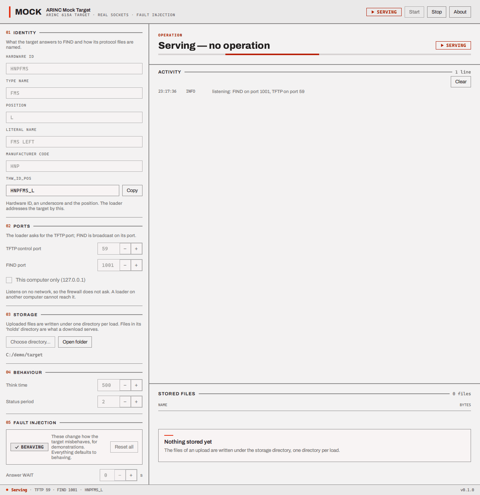
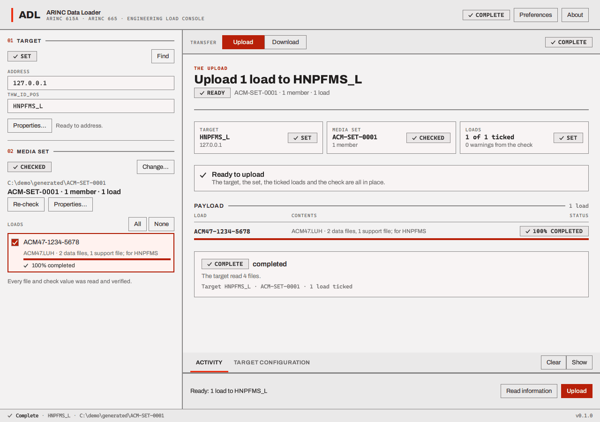
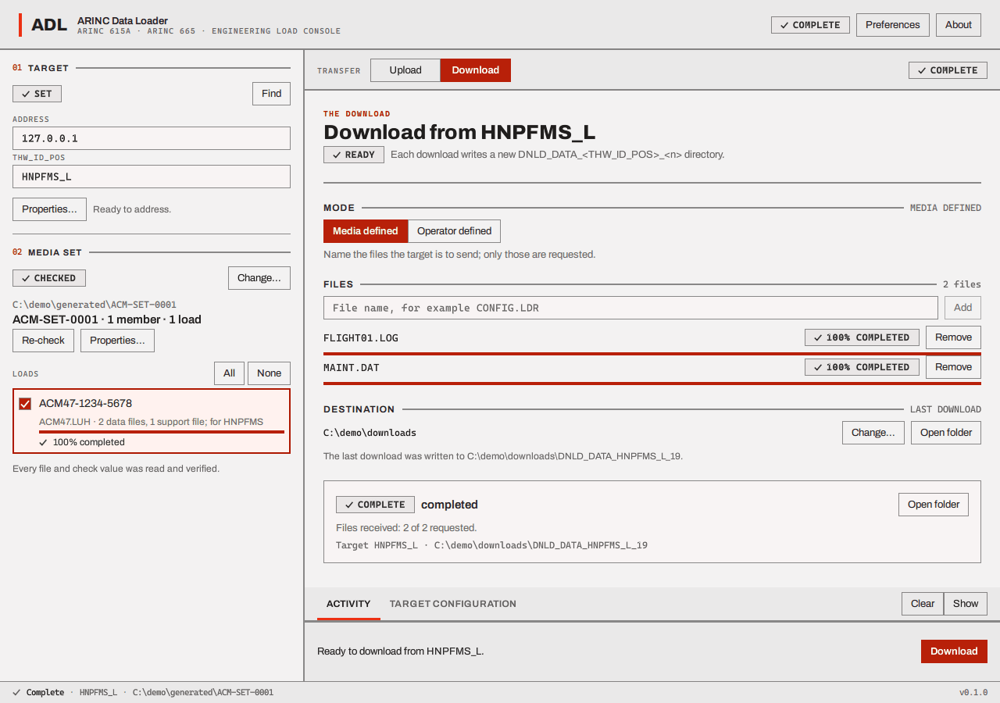

# The demonstration

This walks through the whole job with the three programs on **one computer**, from files on disk to
a finished upload and both kinds of download. It takes about ten minutes and needs no hardware.
Every window shown is the real program. The commands to build the programs are in
[Installing](installing.md); here they are assumed to be built and in one folder.

What happens, in one picture:

```text
  files on disk ──► Media Set Generator ──► media set (a folder tree)
                                                     │
                                                     ▼
     Mock Target ◄── FIND / Information / Upload / Download ──► Data Loader
     (pretends to be equipment, keeps what you upload, serves files to download)
```

Make a working folder, for example `C:\demo`, with three empty folders in it: `sources`, `target`
and `output`. You will put files in `sources` and in `target\holds`.

## 1. Prepare some files

In `sources` put the files of the load: two **data files** and one **support file**. Any files will
do. For the screenshots here: `NAVDATA.LUP` (16 KB), `APPCODE.LUP` (8 KB) and a small text file
`CONFIG.LDR`. Make the data files an even number of bytes (an odd size is accepted but earns a
warning later).

In `target\holds` put two or three small files that the target can give back in a download, for
example `FLIGHT01.LOG`, `FAULTS.TXT` and `MAINT.DAT`.

## 2. Generate the media set

Start **ARINC Media Set Generator**. Fill in the form:

| Where | Enter |
| --- | --- |
| Media set part number | `ACM-SET-0001` |
| Members | `1` |
| Each listed file | `32-bit CRC` |
| FILES.LUM itself | `16-bit CRC` |
| Choose folder... (under OUTPUT) | your `output` folder |
| Load part number | `ACM47-1234-5678` (the check characters `47` are right for this number) |
| Header file | leave `ACM47.LUH` |
| Load type | `Operational software (OPS, ID 0x0001)` |
| Load check value | `32-bit CRC` |
| Target hardware IDs | `HNPFMS`, then **Add** |
| Batch | tick **Include a batch file**, batch part number `ACM4C-0100-0200` |

Press **Add files...**, choose the three files from `sources`, set **CONFIG.LDR** to kind
**support**, and set each file's check value to **32-bit CRC**. When the header chip says
**READY**, press **Generate media set**.


When it says **COMPLETE** the set is in `output\ACM-SET-0001`, and the generator has already read
it back and verified it.


More about every field is in [Make a media set](make-a-media-set.md). You can close the generator.

## 3. Start the mock target

Start **ARINC Mock Target**. Press **Choose folder...** and pick your `target` folder (that is
where it keeps uploads, and where `holds` is). Leave the rest as it is and press **Start**: the chip
turns **SERVING** and the log says `listening: FIND on port 1001, TFTP on port 59`.



(To keep the firewall from asking, tick **This computer only (127.0.0.1)** in the *Ports* block before
pressing **Start**; this demonstration never leaves the computer. See
[Installing](installing.md#what-the-firewall-asks).)

## 4. Start the loader and set it up

Start **ARINC Data Loader**. The first-run screen explains the window; press **Start loading**.


The workbench opens with nothing chosen.


The mock target is on the same computer as the loader and already uses port 59, so the loader must
use another port. Press **Preferences**, set **Control port** to `5900` and, if you like, the
**Download folder**, and press **Save**.


## 5. Find the target

Press **Find**. On a single computer the broadcast does not reach the mock target and the loader
reports "0 targets answered"; that is expected here (on a network with a real target on another
machine it lists the target, see [Find a target](find-a-target.md)).


Type the target by hand: **Address** `127.0.0.1` (this computer) and **THW_ID_POS** `HNPFMS_L`
(the identity the mock target shows). The chip says **SET**.

## 6. Choose the media set

Press **Choose folder...** and pick `output\ACM-SET-0001` (the folder that contains `member_001`). The
loader reads and checks it, the chip goes **CHECKED**, and the load appears in the rail. Tick it
(or press **All**).


**Properties...** next to the media set lists everything the loader found.


## 7. Read the target's information

Press **Read information**. The log shows the request, the target's answer ("accepted") and its
status files; when it finishes, the **TARGET CONFIGURATION** tab of the dock shows what the target
holds.


## 8. Upload

The preflight tiles say Target SET, Media set CHECKED, Loads SET, and the banner says **Ready to
upload**. Press **Upload**. The loader runs the operation: the target reads the header file, the
data files and the support file one by one, and reports its progress in status files.


When it ends the header says **COMPLETE** and each load is at 100%.


Hide the dock (**Hide**) to see the **receipt** under the payload: the outcome, how many files the
target read, and the target and set it was for.



In the mock target the four files are now in its stored files, and on disk in
`target\ACM47-1234-5678\`.


While it runs you will also see red lines "status file transfer failed: HNPFMS_L.LUS (timed out)"
between the status lines. With the mock target these appear with every status file; the status
that follows each is processed as normal, and the operation completes. (Now and then a "status files
lost (1)" line joins them; that is a status file that did not arrive, and is
also harmless here.) See
[Troubleshooting](troubleshooting.md#status-file-transfer-failed-timed-out-with-the-mock-target).

## 9. Download, media defined

Switch to **Download**. The mode is **Media defined**: you name the files. Type `FLIGHT01.LOG` and
press **Add**, then `MAINT.DAT` and **Add**.


Press **Download**. Each file arrives, and the header says **COMPLETE**.


The files are in a new folder `DNLD_DATA_HNPFMS_L_1` inside your download folder; **Open folder**
shows it.



## 10. Download, operator defined

Choose the mode **Operator defined** and press **Download**. The target sends its list of files;
the loader shows them all ticked. Untick one and press **Download selected**.


The two ticked files arrive in a new folder, `DNLD_DATA_HNPFMS_L_2`.

## 11. Watch it go wrong

Stop the mock target (**Stop**). In **05 Fault injection** set **Refuse** to **Refuse Upload**; the
chip says **1 ACTIVE**. Press **Start** again.


In the loader press **Upload**. The target refuses; the loader shows the dialog.


The receipt says **FAILED**, the outcome "denied by the target", and the log has the target's
answer. [The mock target page](mock-target.md#05-fault-injection) lists every fault and what to
expect.

## What you did

You made a valid media set, had the loader check it, and ran every operation the loader has
against a stand-in for equipment, including one that failed. With a real target the steps are the
same from step 4 on, with the target's real address, and (if it follows the standard) FIND in step 5
finds it. Remember that [nothing has been checked against a real target yet](files-and-limits.md#what-has-not-been-checked).

Next: [the loader, screen by screen](loader.md).
