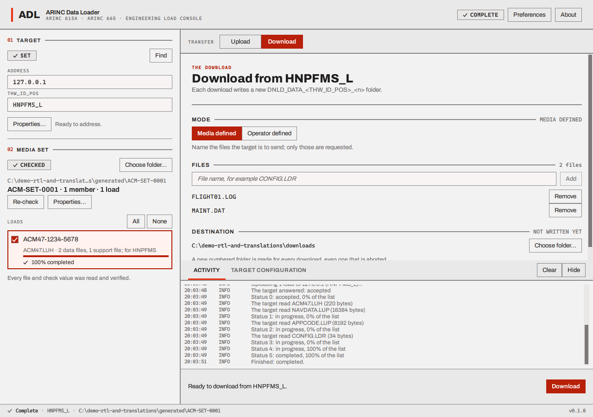
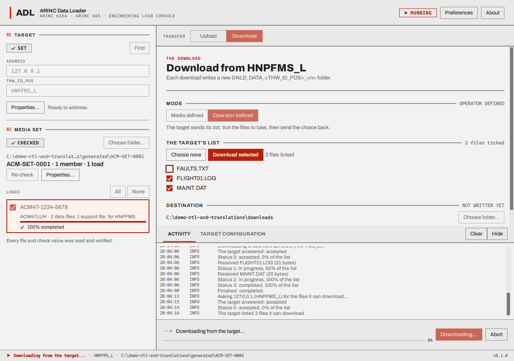
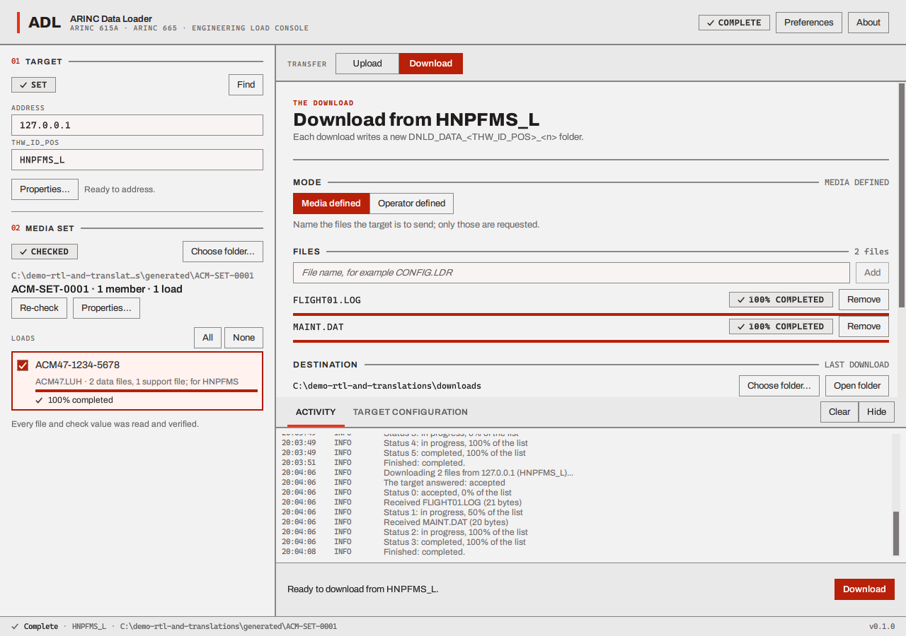

# Download

Download fetches files from the target into a folder on your computer. Switch the work area to
**Download** with the **Upload / Download** switch. Download does not need a media set.

## Where the files go

Every download writes into a **new folder** named `DNLD_DATA_<THW_ID_POS>_<number>` inside the
**download folder**, which is shown under **Destination** and set with **Choose folder...** (or in
[Preferences](preferences.md)). The number is the lowest free one starting at 1. A download that brings back no file (the
target refuses it or never answers, you cancel or abort it, or the loader cannot run it) leaves no
folder behind, so its number is free again; one that brought back even a single file keeps its
folder. A `<THW_ID_POS>` that cannot be part of a folder name (a colon, an asterisk, a question
mark, a quote, an angle bracket, a bar or a character outside printable ASCII) cannot be downloaded
from: **Download** stays dimmed with the usual text in the action bar ("Download needs a target, a
destination and ..."), and no message names the identifier. (The other rules for an identifier are in
[the limits](files-and-limits.md#limits).) A file is written under a temporary name and renamed when
it has arrived whole, and an existing file is never overwritten. **Open folder** opens the folder
of the last download.

## The two modes

The standard has two ways to choose what to fetch. Pick one with the **Mode** choice.

### Media defined: you name the files

Type a file name in **File name** (for example `FLIGHT01.LOG`), press **Add**, and repeat. Each
file you add appears in the list with a **Remove** button. Press **Download**: only these files
are requested. The list holds at most 256 names, and a name that is already in it is ignored. A
name must be a plain name of at most 254 characters, without a path or a slash, and not ending in
`.part`; otherwise it is refused before anything is sent, with a message saying how to name the
file. Switching between **Media defined** and **Operator defined** empties the list.

### Operator defined: the target lists, you pick

Press **Download** with nothing named. The loader asks the target for the list of files it can
give, and the view changes to **The target's list**: every file with a check box, all ticked. Untick
what you do not want, then press **Download selected** to send your choice back. (**Download
selected** is dimmed while nothing is ticked.) **Choose none** cancels instead: it stops the
operation, as the standard says, and the target confirms. The loader does not treat that as a
quiet cancel: the operation ends **FAILED** with the outcome "aborted by the operator", and the
failure dialog opens. No folder is kept, because nothing was received.

## While it runs and when it ends

Each file shows its own status and a progress bar (a file is 0 until it has arrived and 100 after:
the protocol reports no figure in between), and the action bar shows the target's progress through
its list. **Abort** stops it.

When it ends, the header says **COMPLETE** or **FAILED** and a receipt says how many files arrived
of how many were requested, and where.

A download counts as **failed** if the target reports a failed file **or if fewer files arrived
than were asked for** ("completed, 1 file missing"), with the hint "The target did not give back
every file that was asked for. Check the names against what the target can give, and ask it why a
file failed."

Next: [the log, the receipt and failures](log-and-receipt.md).
