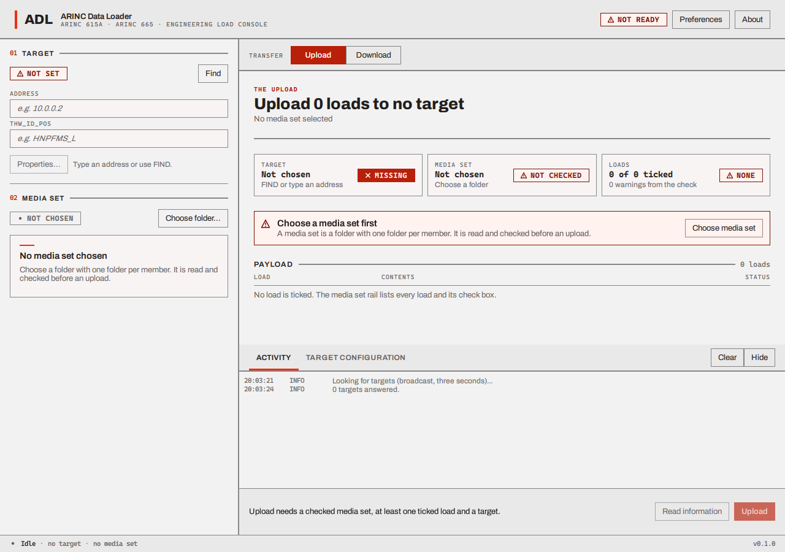
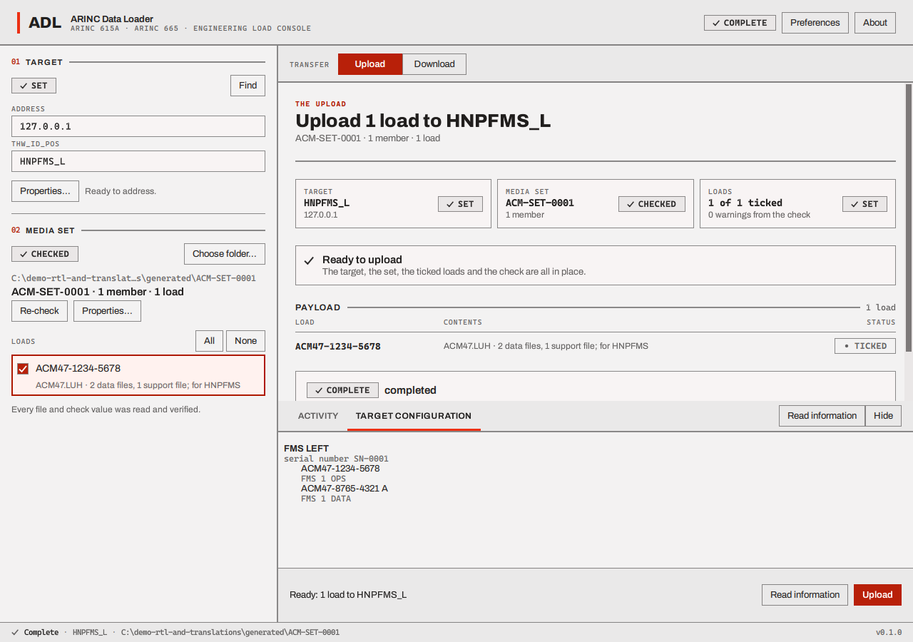

# Find a target and read its information

## Find a target (FIND)

FIND asks the whole local network "who is a target?" and lists every target that answers. Press
**Find** in the **01 Target** block (or **Ctrl+F**, which is **Cmd+F** on a Mac: see
[Keyboard](keyboard.md#shortcuts)). The loader says "Looking for targets (broadcast, three
seconds)...", waits three seconds, and then reports how many answered.

Each answer is a row under **FOUND**: the target's `THW_ID_POS` in bold, and under it its address,
type name and position. **Click a row** to choose it: its address and `THW_ID_POS` are copied into
the two fields and the row is marked **SELECTED**. **Properties...** then shows everything the
target said: hardware ID, type name, position, literal name and manufacturer code.

If the FIND answer gives a hardware ID and a position, the loader makes `THW_ID_POS` from
them with an underscore (`HNPFMS` at `L` becomes `HNPFMS_L`), and from the identifier alone when
there is no position. That reading follows the examples in the standard and has not been checked
against a real target. The field can always be edited.

**If nothing answers.** FIND goes out as a broadcast, which does not cross routers and which a
firewall may block. Targets that do not answer FIND at all, or that you reach over AFDX (a network
that has no broadcast), are named by hand: type the address and the `THW_ID_POS` into the fields.
That is the way to reach a target that does not answer FIND. It needs the target to listen on UDP
port 59 and the identifier to be the one the target expects. See
[Troubleshooting](troubleshooting.md#find-finds-nothing).

**FIND and an operation together.** In [Preferences](preferences.md), **Find the target
automatically** makes the loader run FIND by itself when you start an operation with no usable
target (the chip says **NOT SET**). The log says "No target is selected; looking for one first." If
exactly one target answers, it is taken and the operation starts. If none answers, or several do,
nothing starts and no dialog opens: the answers are listed under **FOUND** and the log says, for
example, "2 targets answered." Pick a target from the list, or type one, and start the operation
again. If exactly one target answers but its `THW_ID_POS` is one the loader cannot use (a download
also needs one that can name a folder: no colon, asterisk, question mark, quotes, angle brackets or
bar), nothing starts and a failure dialog opens that gives the `THW_ID_POS` and the rule; the
loader does not look again.

## Name a target by hand

Type the IPv4 address in **Address** and the identifier in **THW_ID_POS**. The chip says **SET**
when the address is four numbers from 0 to 255 and the identifier is acceptable: 1 to 240
characters, none of them a control character, a slash or a backslash. Until then the chip says
**NOT SET**, the **Target** tile of the Upload view says **MISSING**, and **Read information**,
**Upload** and **Download** stay dimmed. (With **Find the target automatically** on, the tile says
**AUTO** and those buttons are not dimmed for this reason.) The last target an operation was
started against is remembered and put back next time.

## Read information

**Read information** (in the action bar, in the Upload view, and in the dock) runs the *Information*
operation: the loader asks the target to describe itself. It does not change anything on the
target. The log shows "Asking 127.0.0.1 (HNPFMS_L) for its configuration...", then what the
target answers and each status file it writes. When it ends, the **TARGET CONFIGURATION** tab of
the dock lists the target's hardware (with serial numbers) and the software parts installed in it.
The header chip says **COMPLETE** (or **FAILED**) and a receipt appears in the Upload view, as it
does after an upload; the "loads ticked" on its last line only counts the ticks at that moment,
because Information sends no load.

An Information operation can be stopped with **Abort** like the others.

Next: [choose and check a media set](choose-a-media-set.md).
