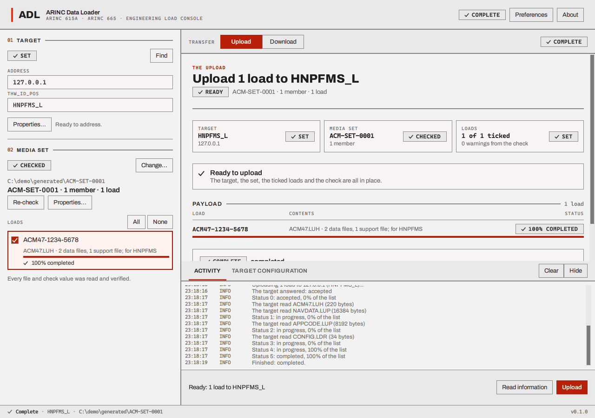

# User's guide

This guide is for the person who prepares loads and puts them into equipment: an engineer or a technician at a bench, not a programmer. It explains three programs that come with ARINC Data Loader and work together, and command-line tools.

| Program | What it is for | Guide |
| --- | --- | --- |
| **ARINC Media Set Generator** (`adl_media_gen`) | Turns files from your disk into a *media set*, the folder layout the loader reads, and checks what it wrote | [Make a media set](make-a-media-set.md) |
| **ARINC Mock Target** (`adl_mock_target`) | Stands in for a piece of equipment, so you can practise, demonstrate and test without hardware, and can be told to misbehave | [Run the mock target](mock-target.md) |
| **ARINC Data Loader** (`adl_app`) | Finds a target on the network, reads what it holds, sends a load to it (*upload*) and fetches files from it (*download*) | [The loader, screen by screen](loader.md) |
| `adl_write_payloads` | Writes sample media sets to a folder, from a command line | [Command line and exit codes](command-line.md) |
| `adl_licence` | Shows the licence on this computer, imports and removes a licence file, from a command line | [Command line and exit codes](command-line.md#adl_licence) |

!!! warning
    This is a preliminary release. Nothing has been checked against real equipment or another vendor's tools. Read [Safety of use](safety-of-use.md) and [Limits and known issues](limits.md) before you rely on the programs for anything that matters.

## Start here

1. [Getting started](getting-started.md): what you need, how to get the programs and check them, and how to start.
2. [What ARINC 615A and ARINC 665 are](concepts.md): a paragraph each, the data model, and the words this guide uses.
3. [The demonstration](demonstration.md): the whole job on one machine in about ten minutes, with a picture of every screen. If you read one page, read this one.

## By task

| I want to... | Read |
| --- | --- |
| Install, check a download and start | [Installing and starting the programs](installing.md), [Verifying a release](../verifying-releases.md) |
| Make a media set from my own files, and know what the standard requires of its names | [Make a media set](make-a-media-set.md) |
| Practise, or show someone, without a real target; make a target misbehave on purpose | [Run the mock target](mock-target.md) |
| Open a media set and have it checked | [Choose and check a media set](choose-a-media-set.md) |
| Find a target, or name one by hand; read what it holds | [Find a target and read its information](find-a-target.md) |
| Send a load to a target | [Upload](upload.md) |
| Fetch files from a target, either way round | [Download](download.md) |
| Understand a line in the activity log, the receipt or a failure message | [The log, the receipt and failures](log-and-receipt.md), [Messages and errors](messages.md), [Findings of the media set check](findings.md) |
| Change a setting, or see what a setting does | [Preferences and the other dialogs](preferences.md), [Configuration reference](configuration.md) |
| Use another language, or the dark colours | [Languages and colour](languages-and-colour.md) |
| Work without the mouse | [Keyboard](keyboard.md) |
| See which edition I have, import a licence file, or find what the licence includes | [Your licence and edition](licence.md) |
| Run the command-line program, or know an exit code | [Command line and exit codes](command-line.md) |
| Fix something that does not work | [Troubleshooting](troubleshooting.md) |
| Look up a number, a port, a file name | [Quick reference](quick-reference.md) |
| See the layout of every file the programs read and write | [Files the programs read and write](../file-reference.md) |
| Know what the programs cannot do, and what has not been checked | [Limits and known issues](limits.md), [What has been checked](../status.md), [Safety of use](safety-of-use.md) |
| Know where files go | [Where files go](files-and-limits.md) |
| Look up a word | [Glossary](../glossary.md) |
| Find a short answer | [Questions and answers](faq.md) |

## About the standards and the pictures

The standards are not part of this software ([the specs page](../specs/README.md)). Where this guide says "the standard", it means ARINC Report 665-3 for media sets and ARINC Report 615A-3 for the loading protocol, which are the editions the code is written from.

The pictures in this guide are real windows of the programs, made again by a script ([how](../screenshots.md)). Windows are shown in the light colours unless a caption says dark. The programs have been used by hand on Windows only.

Each release is published as a package for each system: a zip file for Windows, a tar.gz file for Linux and a disk image for macOS. [Getting started](getting-started.md) covers getting and starting them. For people who build or change the software, [the pages for programmers](../developers.md) start here.
