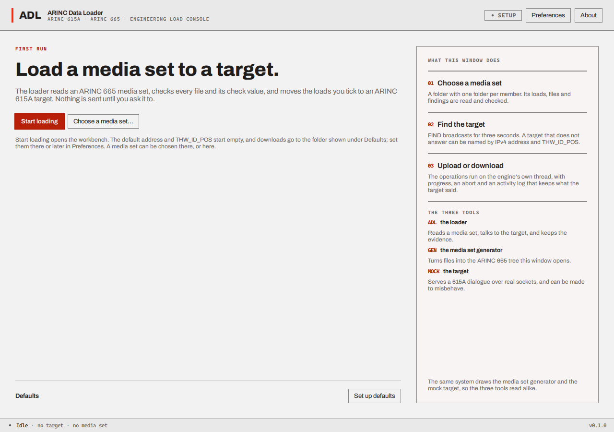

# Installing and starting the programs

## Getting the programs

There is no installer. Each [release on GitHub](https://github.com/iainchesworthlabs/arinc-data-loader/releases)
carries a portable package that holds the programs and the Qt files they need, so nothing has to be
installed first:

| System | Package | To start |
| --- | --- | --- |
| Windows (x86-64) | `arinc-data-loader-<version>-windows-x86_64.zip` | Unpack the folder and double-click `adl_app.exe` (or `adl_media_gen.exe`, `adl_mock_target.exe`) |
| Linux (x86-64) | `arinc-data-loader-<version>-linux-x86_64.tar.gz` | Unpack, then run `bin/adl_app` (the archive also holds `.desktop` files and icons for a launcher) |
| macOS 14.4 or later (Apple silicon) | `arinc-data-loader-<version>-macos-arm64.dmg` | Open the disk image and drag the applications onto the `Applications` link |

The packages are **not signed for any operating system's store**: Windows SmartScreen, macOS
Gatekeeper and similar checks may warn the first time a program starts, because the project has no
certificate they would trust. What a download can be checked against instead (a PGP signature, a
checksum list, a build attestation and a bill of materials) is in
[Verifying a release](../verifying-releases.md); do that before the first start if the warning matters
to you.

The other way is to build the programs from the source code, once, on the machine that will use
them; [Building](../building.md) lists what is needed (CMake, Ninja, a C++23 compiler and the Qt 6.12
libraries) and gives the commands. A Release build is the one to use for work: `windows-msvc-release`
on Windows, `linux-gcc-release` on Linux and `macos-clang-release` on a Mac. The Debug builds are for
developers and, on Windows, cannot open the system's file dialogs (see
[Building](../building.md#presets)).

A build produces these programs in `build/<preset>/bin`, and a package holds the same four:

| File | Program |
| --- | --- |
| `adl_app` | ARINC Data Loader |
| `adl_media_gen` | ARINC Media Set Generator |
| `adl_mock_target` | ARINC Mock Target |
| `adl_write_payloads` | A command-line tool that writes sample media sets to a folder, for trying other loaders |

On Windows the build copies the Qt libraries next to the programs, so each can be started from
anywhere: double-click it, or run it from a shell. A Linux build finds Qt the way the build did (the
Linux package carries its own Qt). On a Mac the programs are application bundles, with Qt inside.

Starting a program opens its window. The programs take one option, `--smoke-test`, which draws the
first frame, prints `smoke-test: first frame drawn` and exits with code 0; you do not need it.
(`adl_write_payloads` is a command-line program, see
[Sample media sets](choose-a-media-set.md#sample-media-sets).) Each program keeps its settings in the
system's per-user settings store; to keep them in a folder instead (when the programs run from a USB
drive, for example) set the environment variable `ADL_SETTINGS_DIR` to that folder
([Where files go](files-and-limits.md#where-files-go)). Closing the window ends the
program (if the loader is busy it asks first, see
[the loader](loader.md#closing-the-window-during-an-operation)).

## The first time you start each program

**The loader** opens on a *first-run* screen: a short statement of what the window does, a button
**Start loading** that opens the workbench, a second button **Choose a media set...** that
opens the workbench and the folder chooser together, and a folded **Defaults** section (**Set up
defaults**) where you can type a default target address, a default `THW_ID_POS` and a download
folder. Everything can be changed later in [Preferences](preferences.md). You see the first-run
screen once; every later start goes straight to the workbench.



**The generator and the mock target** open straight on their only window.

## What the firewall asks

The programs talk over UDP. The first time one of them listens on the network, the operating
system's firewall may stop and ask whether to allow it. The questions are the system's, the answers
are yours, and the programs never change a firewall setting themselves. The helper scripts named in this
section (`tools/network-access/`) are in the source tree and in no release package: take them from the
repository at the tag of the release you use. What each program opens:

| Program | Listens on | When |
| --- | --- | --- |
| Mock target | UDP 1001 (FIND) and 59 (the loader's requests), then a port from 40000 up for each transfer | while it is *SERVING* |
| Loader | UDP 1001 during a FIND; its **control port** (59 unless changed in [Preferences](preferences.md)) and a port the system picks for each transfer | only while it works |
| Generator | nothing | never |

A target on another machine comes back to the loader's ports, so the loader's computer must let
those datagrams in. The ports of a transfer are chosen when it starts (TFTP, RFC 1350), which is why
the helper scripts below allow a *program*, not a list of port numbers.

### The demonstration needs no prompt

When the loader and the mock target run on the same computer nothing has to leave it. Tick
**This computer only (127.0.0.1)** in the mock target's *Ports* block before pressing **Start**, and
type `127.0.0.1` as the loader's target address. The mock target then binds 127.0.0.1 instead of
every interface, and the loader, when its target is a loopback address, does the same for its own
sockets. A program that listens on no network interface raises no firewall prompt on Windows (checked
by starting a program from two new folders: the bind to 0.0.0.0 made Windows create a rule, the bind
to 127.0.0.1 did not). That also keeps unattended runs of the programs from stopping on a prompt
that nobody answers. A loader on *another* computer cannot reach a mock target that is ticked this
way; untick the box for that.

### Windows

**What you see.** Windows Defender Firewall shows "Allow *adl_mock_target* to communicate on these
networks?" the first time a program at an unfamiliar path listens on a non-loopback address. A new
path is any new folder: a different build, a copy of the programs, the same programs after a move.
Pressing *Allow access* makes an inbound rule for that exact path for **TCP and UDP, any port, on
the private and public networks**, which is wider than the programs need. The window stays in front
of other programs until it is answered.

**Make the narrow rule first.** `tools/network-access/windows/adl_firewall.ps1` makes one rule per
program path that allows inbound **UDP only**, on the **Private** profile only, from the **local
subnet** only. Open PowerShell as administrator (right-click, *Run as administrator*) and run it with
the folder that holds the programs:

```powershell
.\tools\network-access\windows\adl_firewall.ps1 -BinDir .\build\windows-msvc-release\bin
```

| Command | Does |
| --- | --- |
| `... -BinDir <folder>` | Adds (or replaces) the rule of each program in the folder |
| `... -Action Show` | Lists every inbound rule that names a program, including the broad ones the prompt made; no administrator needed |
| `... -Action Remove -BinDir <folder>` | Removes the rules this script made for that folder |
| `... -WhatIf` | Says what it would do and changes nothing |
| `-Profile Private,Public`, `-RemoteAddress Any` | Widens the rule; the defaults are the safe ones |

A network that Windows calls *Public* is not covered by the default; the script warns when your
current network is one. Make the network *Private* (Settings, Network and internet), or widen the
rule knowingly. Rules made by the prompt can be removed in *Windows Defender Firewall with Advanced
Security* (`wf.msc`) under *Inbound Rules*, or listed with `-Action Show`.

**Ports 59 and 1001 need no administrator on Windows.** A normal account can bind any port, and no
UAC prompt appears (checked). If a port fails with *permission denied* on Windows it is one the system
has reserved (`netsh interface ipv4 show excludedportrange protocol=udp` lists them); choose another.

### Linux

In the commands below, `build/linux-gcc-release/bin` is where a build from source puts the programs; in
the release package they are in `bin/` (`bin/adl_app`, `bin/adl_mock_target`).


**Ports below 1024.** Linux lets only root (or a program with the `CAP_NET_BIND_SERVICE` capability)
bind ports below 1024. The mock target needs 59 and 1001, and the loader needs its control port,
which is **59 by default**, so on a normal account the loader fails at the start of an operation
until you do one of these (options 1 and 2 checked on Ubuntu 26.04):

1. **Give the programs the capability**, once per file, as root. Nothing else changes:

   ```bash
   sudo setcap cap_net_bind_service=+ep build/linux-gcc-release/bin/adl_mock_target
   sudo setcap cap_net_bind_service=+ep build/linux-gcc-release/bin/adl_app
   ```

      `getcap` shows it and `setcap -r` takes it away. A rebuild replaces the file and with it the
   capability, so repeat it after building. The release package's programs find the Qt libraries in
   the package's `lib/` folder through a path relative to the program; whether that still works for a
   program that has a capability has not been checked, so try it before relying on it. It does not take effect on a filesystem mounted `nosuid`
   (many `/tmp` mounts; the build folder is normally fine). The system also ignores `LD_LIBRARY_PATH`
   for such a program, so a Qt that is found only through that variable is not found; install Qt where
   the system's loader looks, or record its folder in the program's RPATH.
2. **Lower the limit for the whole machine**: ports from 59 up can then be bound by anyone.

   ```bash
   echo 'net.ipv4.ip_unprivileged_port_start=59' | sudo tee /etc/sysctl.d/60-adl-ports.conf
   sudo sysctl --system
   ```

   Delete the file and run `sudo sysctl --system` to undo it. This is a system-wide change.
3. **Use a higher port for the loader.** Set the loader's *Control port* to 5900 (Preferences). The
   target is still addressed on 59, so a mock target still needs option 1 or 2.

**What the mock target says.** If it cannot bind a port it stays *STOPPED* and shows
`the FIND port could not be bound: port 1001: permission denied (a port below 1024 may need extra
privilege; see Troubleshooting)`. The loader's dialog reads "The loader could not use the network or
its port...", and its log line ends `(permission denied)`.

**The Linux firewall.** Most desktops have none in the way. If `ufw` is on, allow your local
network in (`sudo ufw allow from 192.168.1.0/24 proto udp`, with your own subnet); with `firewalld`,
put the subnet in a trusted zone. Neither has been tried with these programs.

**AppArmor.** On Ubuntu, Debian and SUSE a profile can confine each program to what it needs: draw a
window, keep its settings, use UDP, bind a low port and touch the user's own files. The generator's
profile has no network access at all. `tools/network-access/linux/install_apparmor.sh` writes the
three profiles for a build folder and loads them in **complain** mode, in which nothing is blocked
and what would have been blocked is logged:

```bash
sudo tools/network-access/linux/install_apparmor.sh \
    --bin-dir "$PWD/build/linux-gcc-release/bin" --qt-dir ~/Qt/6.12.0/gcc_64
# use the programs through a whole session, then read what would have been denied:
sudo aa-logprof              # or: sudo journalctl -k | grep 'apparmor="ALLOWED"'
# when it is quiet, enforce (the same command with --enforce), or take them away:
sudo tools/network-access/linux/install_apparmor.sh --remove
```

`--print` shows the finished profile and checks that `apparmor_parser` accepts it, without
installing anything. Additions go in `/etc/apparmor.d/local/adl_app` (or `adl_mock_target`,
`adl_media_gen`), which survive a reinstall. The profiles let a program write anywhere under the
user's home, `/media`, `/run/media`, `/mnt` and `/tmp`, because the operator chooses where media
sets and downloads go; to narrow that, edit the template's `owner @{HOME}/** rwk,` lines to the
folders you use. The profiles were **parsed, installed and removed** on Ubuntu 26.04 under WSL 2,
whose kernel has no AppArmor, so they have **not been enforced against a running program**: do the
complain-mode session above before trusting them.

**SELinux.** A program you start from your own session runs in the unconfined domain and SELinux
changes nothing for it. A confined domain (a service you wrote, a container) needs the port
labelled, `sudo semanage port -a -t <type> -p udp 59` (and 1001), and a denial shows in
`sudo ausearch -m avc -ts recent`. The project ships no SELinux policy.

### macOS

**The application firewall** (System Settings, Network, Firewall) shows "Do you want the application
*adl_mock_target* to accept incoming network connections?" when it is on and a program that is not
signed by a trusted developer starts to listen. Answer *Allow*, or register the programs beforehand
with `sudo tools/network-access/macos/adl_macos_firewall.sh add <each .app>` (`status` lists them).
Loopback traffic is not filtered, so the demonstration setting above avoids it.

**Ports below 1024.** Since macOS 10.14 a program may bind a low port without root, but only to
*every* interface (0.0.0.0); binding a low port to a single address such as 127.0.0.1 may still need
root. So on a Mac the mock target's **This computer only** setting can fail with *permission denied*
on ports 59 and 1001; leave it off, or run the mock target as root.

These two macOS statements come from Apple's documentation and reports from other projects; this
project has **not tried them** on a Mac.

## Windows that remember

Each program remembers its window size and position between runs, and the loader remembers its
[Preferences](preferences.md), the last media set folder and the last target. Where this is kept
depends on the system (on Windows, the registry under
`HKEY_CURRENT_USER\Software\iainchesworthlabs\`); see
[Where files go](files-and-limits.md#where-files-go).

## The colours

The windows follow the desktop's light or dark setting: there is no switch inside the programs.
See [Languages and colour](languages-and-colour.md).

Next: [the demonstration](demonstration.md).
