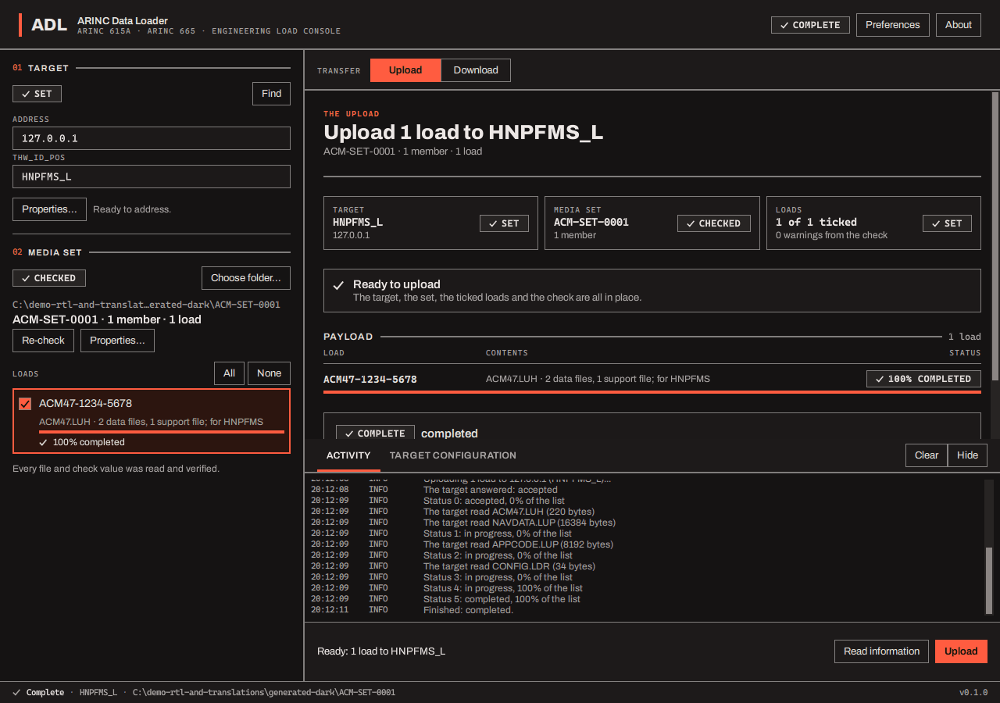

# Languages and colour

## Language

All three programs can change language: the loader in **Preferences > Language**, the generator
and the mock target in the language box in their header, beside About. The list has eight: English,
French (Français), Spanish (Español), German (Deutsch), Yiddish (ייִדיש), Hebrew (עברית), Simplified
Chinese (中文) and Japanese (日本語). The choice applies to the open window at once and is
remembered (by each program for itself). On the first start the loader uses the system's language if it is one of these,
otherwise English.

**What is and is not translated.** Every piece of text in the three programs is translated into
the seven languages, but the translations are a **machine-drafted first version that no native
speaker has reviewed**: expect wording an engineer would put differently, in Hebrew and Yiddish
especially. A speaker who wants to improve one can: see [Translations](../translations.md). Some text
stays in English in every language because it does not belong to the window: the standard's findings
about a media set and the names of the ARINC 665 library's errors, what the target itself says (its
names, its descriptions), the names of the check-value algorithms, error codes of the system in
parentheses, and the activity lines the mock target writes about its own protocol work. A change of
language also changes what is already on screen (the result of the last operation, the log, a
failure that is showing).

**Hebrew and Yiddish** are written right to left, and the whole window follows: the context column
moves to the right, the buttons of the header and a choice between segments swap sides, check boxes
sit on the right of their labels, and a progress bar fills from the right.

**Typefaces.** The programs are set in Archivo, which has no Hebrew letters: Hebrew and Yiddish use
the Noto Sans Hebrew typeface that comes with the programs. It has no Chinese or Japanese characters
either, and none comes with the programs: those two languages need a Chinese or Japanese font on the
system, which Windows, macOS and ordinary Linux desktops have (a bare container does not, and shows
boxes).

## Colour

The three programs follow the desktop's colour scheme: light when the desktop is light, dark when
it is dark. There is no switch inside the programs. To change it, change the setting of the
system (on Windows, *Settings > Personalisation > Colours > Choose your mode*). The programs follow it while they run; if one does not, restart it.

The colours are a deliberately small set: neutral greys and one red, and every state has a mark of
its own as well as a word, so the meaning never depends on telling two colours apart:
a check for success ("COMPLETE", in the neutral colour), a warning triangle for a warning, a cross on a
filled red chip for a failure, a play mark while something runs. The activity log names its
severity in words (INFO, NOTE, WARN, ERROR).

The programs follow the desktop's "reduce motion" setting: with it on, the busy mark and the sweeping
progress bar stand still.

The programs have no text size setting of their own yet.
