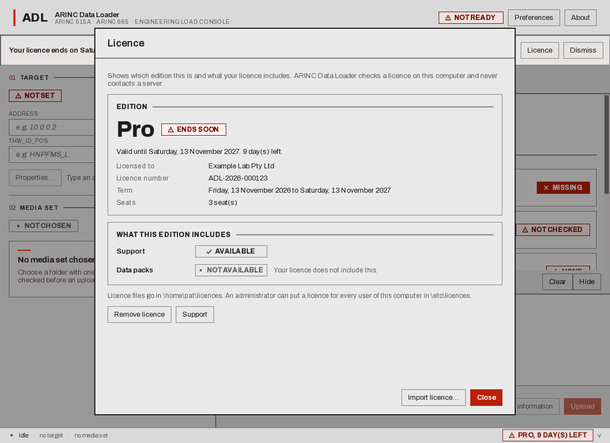
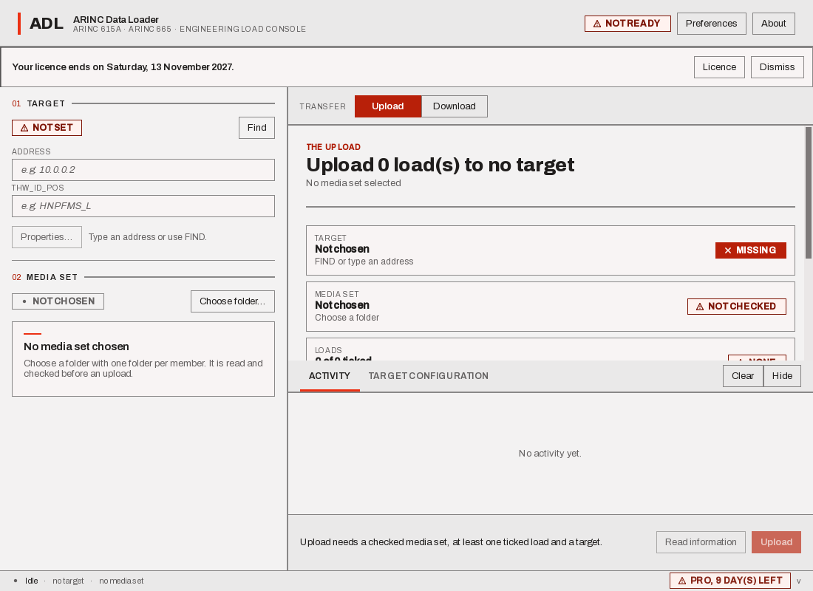
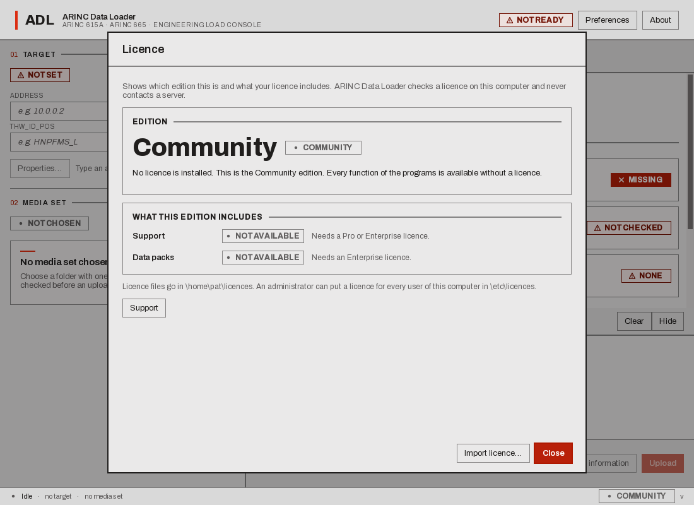
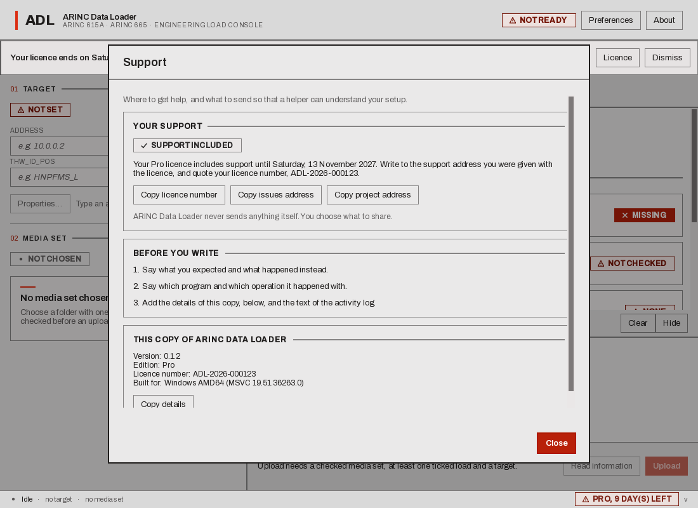

# Your licence and edition

ARINC Data Loader is free software, and every function of the programs works without a licence. A
**licence file** records that a paid **edition** was bought: **Pro** or **Enterprise**. With no
licence, or with one that has ended, the programs are the **Community** edition.

A licence file does not change the terms the programs are under ([licensing](../licensing.md)), and nothing in
a program is switched off by one. The programs show what the licence says. What a paid edition adds is
support, supported versions and data packs, which come as a service and as documents, not as functions of
the programs.

One licence file on a computer serves all of the windowed programs: the loader, the media set generator
and the mock target. Each of them shows the edition in the same places. `adl_write_payloads` has no window
and shows nothing. `adl_licence` has no window either: it is the command line for the same licence files, for a
computer with no display and for scripts ([With the command line](#with-the-command-line)).

ARINC Data Loader checks a licence on this computer and never contacts a server. It sends nothing and counts
nothing. It reads the name of the computer only to compare it with the computers a licence names.

## Where the programs show it

| Where | What it shows |
| --- | --- |
| The **edition chip**, at the right of the status bar | The edition, and when the licence is ending or has ended, how much is left. Press it to open the Licence window |
| The **Licence** window | Which edition this is, whose licence it is, for how long, what it includes, every licence file found, and the buttons that import and remove one |
| The **notice** under the header | One line, when a licence ends soon, is in its grace period, has ended, or when the date of the computer looks wrong. It never blocks anything |
| **About** | The line **Edition**, and a **Licence...** button. The **Licences** button of About is the third-party notices, which is another thing |
| The **Support** window | What the licence says about support, what to send when you ask for help, and the details of this copy |

The words **Licence** and **Licences** are two things: **Licence** is your edition, and **Licences**, in About, is
the list of the other people's software the programs carry, with their licences.

## The edition chip

| The chip says | When |
| --- | --- |
| **Community** | No licence file, or a licence that has ended, has not started, is not valid or cannot be judged |
| **Pro** or **Enterprise** | A licence in its term. A trial says **Pro trial** or **Enterprise trial** |
| **Pro, *n* days left** | The licence ends in 30 days or fewer (a trial: 3 days or fewer) |
| **Pro, ends today** | The last day |
| **Pro, licence ended** | The licence has ended and is in its grace period |

The chip is a button: the keyboard reaches it with Tab, and Enter or Space opens the Licence window. Its tone is
shown by a mark as well as by colour.

## What the Licence window says

The window has the edition in large letters, a chip with the state, and one sentence about it. Under that are
the rows of the licence: who it is **Licensed to**, the **Licence number**, the **Term**, the **Seats** and the
**Computers** it names. A row that has nothing to say is left out.

| State | Chip | Sentence |
| --- | --- | --- |
| None | **Community** | No licence is installed. This is the Community edition. Every function of the programs is available without a licence. |
| Valid | **Valid** | Valid until *date*. |
| Ends soon | **Ends soon** | Valid until *date*. *n* days left. On the last day: Valid until *date*. It ends today. |
| Grace period | **Ended** | Ended on *date*. The grace period lasts until *date*. |
| Ended | **Ended** | Ended on *date*. This is the Community edition again. Nothing you made is lost: media sets, receipts and logs are unchanged. |
| Not started | **Not started** | Starts on *date*. |
| The date looks wrong | **Check the date** | The date on this computer looks wrong, so the licence cannot be judged until the date is right. |
| Not valid | **Not valid** | One of the sentences below |

A licence that is **not valid** says why:

| Why | Sentence |
| --- | --- |
| The file is damaged, incomplete or not a licence | This file is not a valid ARINC Data Loader licence. It may be damaged or incomplete. Ask for the file again. |
| It was made for a newer version | This licence needs a newer version of ARINC Data Loader. Install the latest version, then import the licence again. |
| It was withdrawn | This licence was withdrawn. Contact support. |
| It names other computers | This licence is for other computers. This computer is *name*. Ask your administrator for a licence that names it. |
| It is for another product | This licence is for another product. Ask for an ARINC Data Loader licence. |

Dates are shown in the language and the time zone of the computer. The **Seats** row says **Site licence** for a
licence that has no seat count, and otherwise the number: *n* seats. What a seat is, is in the terms of the
licence, and the programs count nothing.

### What this edition includes

A licence names the features it carries. The edition alone grants nothing. The window lists the two there are
and says why one is not available:

| Feature | Not available because | Sentence |
| --- | --- | --- |
| **Support**, **Data packs** | There is no licence | Needs a Pro or Enterprise licence. (Data packs: Needs an Enterprise licence.) |
| Either | The licence does not list it | Your licence does not include this. |
| Either | The licence has ended | Your licence ended on *date*. |
| Either | The licence has not started | Your licence starts on *date*. |
| Either | The date looks wrong | The date on this computer looks wrong. |
| Either | The licence is for other computers | Your licence is for other computers. |
| Either | The licence is not valid | The installed licence is not valid. |

A licence in its grace period still counts. A feature that is not available switches nothing in the programs
off: **Support** and **Data packs** are a service and documents, so there is nothing in a program to turn off.

## The notice under the header

| When | Words | Button that puts it away |
| --- | --- | --- |
| The licence ends in 30 days or fewer (a trial: 3) | Your licence ends on *date*. | **Dismiss** |
| The licence is in its grace period | Your licence ended on *date*. Its grace period ends on *date*. | **Remind me tomorrow** |
| The licence has ended | Your licence has ended. This is the Community edition again, and nothing you made is lost. | **Dismiss** |
| The date looks wrong | The date on this computer looks wrong, so the licence cannot be judged. | **Dismiss** |

Each notice has a **Licence** button that opens the Licence window. A notice is never a dialog and never takes
the focus. **Dismiss** keeps it away for that licence in that state, and the program remembers that between runs,
in its settings. The date warning is put away only until the program is closed. **Remind me tomorrow** hides
the grace period notice for the day.

## Import a licence

1. Press **Import licence...** in the Licence window. A file chooser opens with the filter **Licence files
   (\*.adllic)**.
2. Choose the file. The program checks it on this computer. A file is copied into your licence folder only if it
   is a licence this program can use. The original stays where it was.
3. The window says what happened.

| Result | What the window says |
| --- | --- |
| A licence in its term | Licence imported. This is now the *edition* edition. |
| The same file is already there | Licence imported: That licence is already installed. It is not copied twice. |
| A licence that has ended | This licence ended on *date*. It was imported, but it includes nothing now. |
| A licence in its grace period | This licence ended on *date*. It was imported, and its grace period lasts until *date*. |
| A licence that has not started | This licence starts on *date*. |
| The date looks wrong | The date on this computer looks wrong, so the licence cannot be judged yet. It was imported. |
| A list of withdrawn licences | List of withdrawn licences imported: The list was imported. A licence on it is shown as withdrawn. |
| A file the program cannot use | Could not import the licence, and the sentence for the reason from the table above. Nothing is copied |
| A file that cannot be opened | Could not import the licence: ARINC Data Loader could not read *file*. Check that the file still exists and that you are allowed to open it. |
| The licence folder is full | Could not import the licence: The licence folder already holds 64 files. Remove one, then import again. |
| The folder cannot be written | Could not import the licence: The licence could not be saved in *folder*. Check that the folder can be written. |

An import never replaces a file and never deletes an older one. A file that is refused never replaces a valid
licence.

A licence that has ended, or has not started, is imported all the same: it is your file, and the window says
which state it is in. One that is withdrawn, or names other computers, is refused.

### Several licence files

If more than one file is found, the window lists them under **Licence files on this computer**, and the
program uses the licence that gives you the most: a licence in its term before one in its grace period before
one that has ended, then Enterprise before Pro, then the one that ends later. A file that an administrator put in
the machine folder is marked **Installed by an administrator**, and has no **Remove** button.

### Remove a licence

**Remove licence** takes the licence file in use out of your licence folder, after asking: **Remove this
licence?** The answer that keeps the file is the default. The program is then the Community edition again, and
media sets, receipts and logs are unchanged. Keep the licence file so that you can import it again. A file in
the machine folder is never removed by the program.

If a file cannot be removed the window says: Could not remove the licence. The file *name* could not be removed from *folder*.

## With the command line

`adl_licence` does what the Licence window does, with no window ([Command line and exit codes](command-line.md#adl_licence)).
It reads and writes the same files in the same folders, so a licence imported with one is there for the other.

| To | Run |
| --- | --- |
| See the edition, the licence in force and every licence file | `adl_licence show` |
| Import a licence file, or a list of withdrawn licences | `adl_licence import <file>` |
| Check a file as a program would, and keep nothing | `adl_licence verify <file>` |
| Remove a file from your licence folder | `adl_licence remove <name>` |

The sentences it prints for an import are the ones of [the table above](#import-a-licence), in English only. Two
things differ from the window. `show` and `verify` never write anything, not even the clock file; the windows keep
the latest time they have seen, and the command line does not. And `import` and `verify` judge a file with the
signed lists of withdrawn licences already in your folders, so a licence that one of them withdraws is refused
and not imported.

`adl_licence show` prints the state as one word that is the same in every language, so that a script can read
it: `none`, `valid`, `expiring`, `grace`, `expired`, `not_yet_valid`, `clock_suspect` or `invalid`.

## Where licence files go

| What | Windows | Linux | macOS |
| --- | --- | --- | --- |
| Your licence folder (an import goes here) | `%LOCALAPPDATA%\ARINC Data Loader\licences` | `$XDG_DATA_HOME/arinc-data-loader/licences`, or `~/.local/share/arinc-data-loader/licences` | `~/Library/Application Support/ARINC Data Loader/licences` |
| The machine folder (read only: an administrator puts a licence for every user here) | `%ProgramData%\ARINC Data Loader\licences` | `/etc/arinc-data-loader/licences` | `/Library/Application Support/ARINC Data Loader/licences` |
| The clock file | `licence-clock.json` in the folder above your licence folder | the same | the same |

The Licence window shows the two folders of this computer. The programs read the files in them that end in
`.adllic` (a licence) and `.adlrev` (a signed list of withdrawn licences), in name order, up to **64 files from
each folder**, and nothing larger than **64 KiB**. A file that is larger, or is damaged, is listed as not valid
and hides nothing else.

`ADL_SETTINGS_DIR` moves the licence folders and the clock file together with the settings, so that a test run
never reads a real licence: your licence folder becomes `licences`, the machine folder `machine-licences` and the
clock file `licence-clock.json`, all inside the folder that variable names.

## The date

The program keeps the latest time it has seen in the clock file. It also knows when its source was committed, and
the date a licence was issued. It does not accept a computer clock more than 48 hours behind the latest of them. That is how a licence is judged
**Check the date** when a computer's clock has been set back. It is a check for honest mistakes, not a lock: the
clock file is a plain file, and deleting it only makes the program forget the time. A computer with no licence
file keeps no clock file.

If a clock once ran far ahead and the program remembers that, the owner can send a licence that carries a reset
token. Importing it sets the stored time back to the day the licence was issued, once.

A test bench whose clock is reset when it is switched off may show **Check the date**. With nothing switched
off by a licence, that changes only what this window says, and the licence file stays valid.

## What a customer sees until the keys are in

A licence is checked against the public keys that are built into the program. This version has none, so it
cannot check a licence file yet, and every file is refused. Importing one says:

**This version of ARINC Data Loader cannot check licence files yet, so it accepts none. The Community edition works as it always did.**

A file already in a licence folder shows **Not valid** with the same sentence, and the chip says **Community**. The
programs work as they did before. A release that carries the keys accepts the licences made for them, and until
then nothing about a program depends on a licence.

A computer with no licence file at all shows the Licence window like this:

## The Support window

**Support** (a button in the Licence window) is three cards. It copies to the clipboard and does nothing else: it
opens no web browser and no mail program, and sends nothing. ARINC Data Loader never sends anything itself. You
choose what to share.

| What the licence says | Chip | Words |
| --- | --- | --- |
| It lists support and is in its term or grace period | **Support included** | Your *edition* licence includes support until *date*. Write to the support address you were given with the licence, and quote your licence number, *number*. |
| It lists support and has ended | **Support ended** | Support ended with your licence on *date*. |
| Anything else | **Community support** | No licence that includes support is installed. Read the guide first, then open an issue on the project's GitHub page. The Community edition has no support promised; the maintainer is one person. |

**Before you write** gives three lines: say what you expected and what happened instead, say which program and
which operation it happened with, and add the details of this copy and the text of the activity log.

**This copy of ARINC Data Loader** gives the lines a helper asks for first, in a fixed font, with a **Copy details**
button: **Version**, **Edition**, **Licence number** (when there is one) and **Built for** (the system the
program was built for).

The buttons **Copy licence number**, **Copy issues address** and **Copy project address** put that text on the
clipboard and say so (for example, Licence number copied.).

## Words

A licence is a **licence file**, with a **licence number**. The person it is **Licensed to** is the licensee. The
editions are **Community**, **Pro** and **Enterprise**. A licence that has stopped has **ended**. The grace period
is the time after the end during which what the licence includes still counts. There is no activation and no
registration, and nothing to unlock: the programs say none of those words, because none of them happens.

## What the programs keep and send

- **Kept**: the licence files you import (a copy), the clock file, and in the program's settings which notice you
  put away. See [privacy](../privacy.md).
- **Sent**: nothing. The program reads files on this computer and never opens a connection to check a licence.

See also: [the command line](command-line.md) (`adl_licence`, and the programs' options, which do not change), [privacy](../privacy.md),
[where files go](files-and-limits.md) and [the configuration reference](configuration.md).
