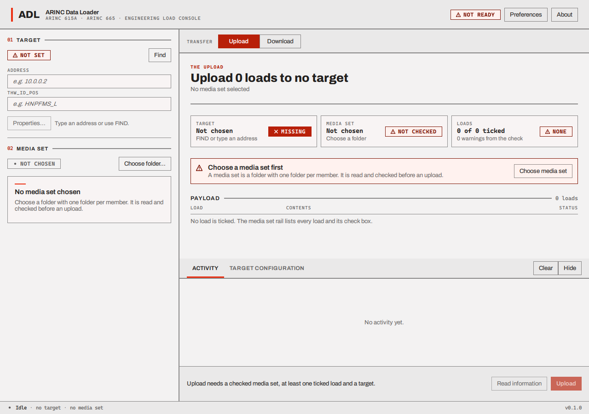
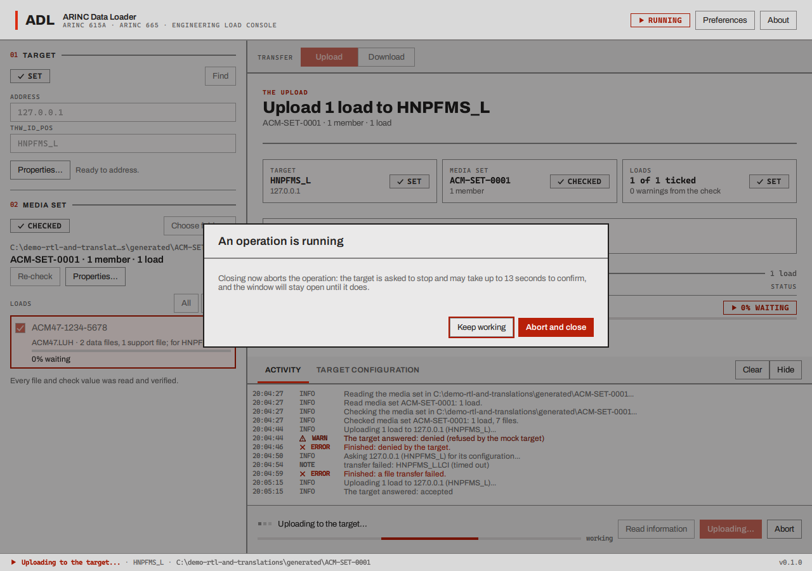

# The loader, screen by screen

The **ARINC Data Loader** has one working window, the **workbench**, plus a few dialogs. This page
shows how the workbench is laid out; the tasks have their own pages.

## The header

At the top: the **ADL** mark and the name, a **readiness chip** (**SETUP** on the first-run screen,
**NOT READY**, **READY**, **RUNNING** while a job runs, then **COMPLETE** or **FAILED** until the next one; the status bar at the bottom says the same), and the buttons
[Preferences](preferences.md) and **About**.

## The rail (left): what you are working with

The rail has two numbered blocks. It scrolls by itself when the window is short; the action bar
never does.

**01 Target** is the equipment to talk to.

- A chip says **SET** when the address and `THW_ID_POS` form something the loader can use, or
  **NOT SET**.
- **Find** looks for targets on the network (FIND), see
  [Find a target](find-a-target.md). The targets that answered are listed under **FOUND**; click
  one to fill in its address and `THW_ID_POS` (its row says **SELECTED**).
- **Address** takes the target's IPv4 address, four numbers from 0 to 255 separated by dots
  (`10.0.0.2`), and **THW_ID_POS** its identifier (`HNPFMS_L`). Type them yourself for a target
  that does not answer FIND (or one reached over AFDX, which has no broadcast).
- **Properties...** shows what is known about the target ([Preferences and the other
  dialogs](preferences.md#target-properties)).

**02 Media set** is what to upload, see [Choose and check a media set](choose-a-media-set.md).

- A chip says **NOT CHOSEN**, **CHECKING**, **CHECKED**, **INVALID** or **UNCHECKED**.
- **Choose folder...** picks the folder; **Re-check** reads and checks
  it again; **Properties...** shows everything in it.
- **LOADS** lists the loads in the set, each with a check box; **All** and **None** tick and
  untick every one. The ticked loads are what an upload sends. While an upload runs, each ticked
  load shows its own progress bar, percentage and status here.
- **WARNING** lines list where the set departs from the standard's recommendations.

## The work area (right)

A strip at the top, **TRANSFER**, has the switch **Upload / Download**. The switch cannot be
changed while a job runs. Whether the loader can work is said once, by the chip in the header; the
panels say what is missing, and a finished transfer says how it ended in its receipt.

- **Upload** shows the plan ("Upload 1 load to HNPFMS_L"), the three **preflight tiles**
  (Target, Media set, Loads; each with a chip that says whether it is in place), a banner that
  says what to do next or "Ready to upload", the **payload** (the loads that will be sent, with
  their contents and status) and, after a transfer, the **receipt**. See [Upload](upload.md).
- **Download** shows the mode (**Media defined** or **Operator defined**), the files, and the
  destination folder. See [Download](download.md).

## The dock (below the work area)

Two tabs: **ACTIVITY**, the log of what the target said and what the loader noticed, and
**TARGET CONFIGURATION**, the hardware and parts a target reported when you pressed **Read
information**. **Clear** empties the log; **Hide** / **Show** collapses the dock. See
[The log, the receipt and failures](log-and-receipt.md).

## The action bar (bottom)

Always visible. On the left: what is happening or what is missing ("Upload needs a checked media
set, at least one ticked load and a target."), and a progress bar with a percentage while a job
runs. On the right:

- **Read information** (Upload view only) asks the target what it holds.
- The one main button, **Upload** or **Download**, dimmed until everything needed is in place.
- **Abort**, only while an operation (not a FIND or a media set check) is running.

## The footer

The state (**Idle**, what is being done, **Complete**, **Failed**), the target, the media set
folder and the version.

## Closing the window during an operation

If a job is running, closing the window asks first.

**Keep working** closes the question. **Abort and close** asks the target to abort and closes when it
confirms, which can take up to 13 seconds.

## What a first start looks like

See [Installing and starting the programs](installing.md#the-first-time-you-start-each-program).
