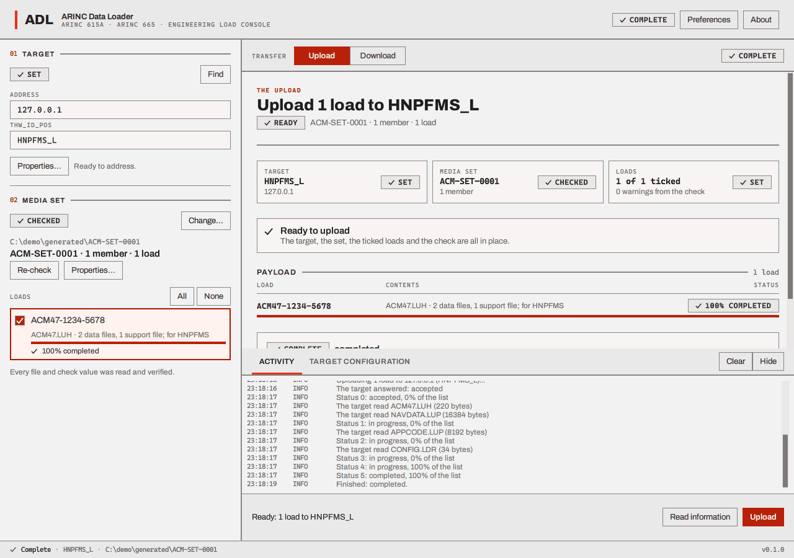
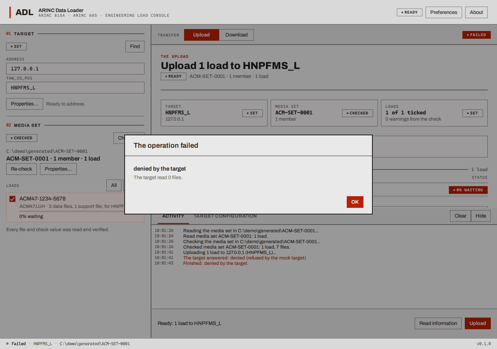

# The log, the receipt and failures

## The activity log

The **ACTIVITY** tab of the dock records, oldest first, what the target said and what the loader
noticed, each line with the time. It follows the newest line until you scroll up. Each line names its
severity in a word (**INFO**, **NOTE**, **WARN** with a warning triangle, **ERROR** with a cross), and a
warning or an error is also set in its own ink, so a copied or printed log reads the same. The log
takes the keyboard (Tab to it, Up, Down and Page keys to scroll, **Ctrl+C** to copy it all, **Cmd+C**
on a Mac).
**Clear** empties the log. It is kept in memory only (see
[Where files go](files-and-limits.md#where-files-go)).

### Lines you will see

| Line | Meaning |
| --- | --- |
| `Looking for targets (broadcast, three seconds)...` / `2 targets answered` | A FIND started, and how it ended |
| `Asking 127.0.0.1 (HNPFMS_L) for its configuration...` | An Information operation started |
| `Uploading 1 load to 127.0.0.1 (HNPFMS_L)...` / `Downloading 2 files from ...` | An upload or a media defined download started |
| `Asking 127.0.0.1 (HNPFMS_L) for the files it can download...` | An operator defined download started |
| `No target is selected; looking for one first.` | **Find the target automatically** is on and there was no usable target, so a FIND runs before the operation (see [Find a target](find-a-target.md#find-a-target-find)) |
| `The target that answered cannot be used: its THW_ID_POS is "..."` | **Find the target automatically** is on, exactly one target answered, and its `THW_ID_POS` is one the loader cannot use (for a download, one that cannot name a folder). Nothing is started (see [Find a target](find-a-target.md#find-a-target-find)) |
| `The target answered: accepted` | The target's answer to the request. *Accepted* is good; *denied* or *not supported* is a refusal, with the target's reason in brackets |
| `Status 3: in progress, 50% of the list, about 6 s left` | A status file. The *counter* grows by one with every file the target writes. The percentage is how far the target's list of loads or files has got; the time is the target's own estimate, shown only when it gives one |
| `The target read ACM47.LUH (220 bytes)` | During an upload, a file the target has read from the loader |
| `Received FLIGHT01.LOG (1021 bytes)` | During a download, a file that has arrived |
| `The target failed load ACM47-1234-5678 (ACM47.LUH): <reason>` / `The target failed file X: <reason>` | The target gave up on one load or file and said why. Logged once |
| `The target listed its configuration.` / `The target listed 3 files it can download.` | The answer to an Information request, or the list of an operator defined download |
| `Nothing was received, so the empty download folder <path> was removed.` | A download brought back no file, so the folder made for it was removed (see [Download](download.md#where-the-files-go)) |
| `Finished: completed.` | The operation ended, and how (see the outcomes below) |
| `Reading the media set in ...` / `Read media set ACM-SET-0001: 1 load.` / `Checking the media set in ...` / `Checked media set ...: 1 load, 3 files.` | The media set read and check |

The loader also reports **notices**: things the protocol engine saw that are worth knowing. They
are **NOTE** lines in the log, written in the ordinary ink like **INFO** lines, not in the ink of a
warning or an error. They read as a name, then the file or detail, then a number if there is one:

| Notice | It means |
| --- | --- |
| `status files lost` | The target's status file counter jumped: some status files never arrived. Not an error by itself |
| `status file repeated`, `status file out of order` | A status file arrived twice, or an old one after a newer one. It is ignored |
| `status file transfer failed` | One status file could not be transferred; the loader goes on |
| `checksum did not match` | A file the loader received does not match the check value the target sent with it. The transfer is not failed by this alone, but the file should not be trusted |
| `checksum algorithm not supported` | The target used a check value the loader cannot calculate |
| `file not available` (n s) | The target is not ready to give the file yet and asks to try again after n seconds |
| `request refused` | The target refused a request |
| `transfer failed` | A file transfer failed; the outcome says how |
| `target asked to wait` (n s) | The target answered WAIT: "not yet, ask again in n seconds" |
| `options refused, asked again without them` | The target did not accept the loader's transfer options (block size and so on), so the loader asked again without them |
| `port option not taken by the target` | The loader asked the target to use another port for the files it serves (this is what lets both share a machine) and the target ignored it |
| `requested files missing` | A download: some of the files you asked for never arrived |

## The outcome

How an operation ended is always one of these, in the receipt and in `Finished: ...`:

| Outcome | Meaning |
| --- | --- |
| completed | The target said it finished without error. (A completed *Upload* with a failed load, or a *Download* with a failed or missing file, is shown as a failure: "completed, 1 load failed", "completed, 1 file missing") |
| denied by the target | The target refused the operation (status 0x1000) |
| not supported by the target | The target does not do this operation (0x1002) |
| aborted by the operator | You pressed **Abort**. The detail says whether the target confirmed that it stopped |
| aborted by the data loader | The loader ended it because of an error of its own |
| aborted by the target | The target stopped (0x1003) |
| unsupported protocol version | The target speaks a version of the protocol other than A4 |
| a file transfer failed | A file could not be transferred after the retries |
| data load protocol time-out | No status file for 13 seconds |
| the target was silent longer than its exception timer | The target said it would be quiet for a while and stayed quiet longer |
| protocol error | A file of an invalid structure, or one that arrived out of turn |
| local error | The loader could not read or write something it needed (a file, the download folder) |
| the media set changed after it was checked | Upload only: a file of the set was edited, replaced or removed after the check. The detail names the file; see [Upload](upload.md#which-files-the-target-gets) |

## The receipt

After a transfer the work area shows a **receipt**: a chip (**COMPLETE** or **FAILED**), the
outcome, the detail, and a last line. For an upload the detail says how many files the target read
("The target read 3 files."), for a download how many files arrived of how many were requested and
where they went, and for an abort whether the target confirmed that it stopped.

- The last line of an **upload** receipt gives the date and time the operation ended, the target,
  the media set and how many loads were ticked: for example `2026-10-21 20:03:51 · Target
  HNPFMS_L · ACM-SET-0001 · 1 load ticked`.
- The last line of a **download** receipt gives the target and the folder the files went to
  ("no folder" when none was kept), with no time.
- A **Read information** run also ends with **COMPLETE** or **FAILED** in the header and a receipt
  in the Upload view, in the form of the upload receipt.

The receipt belongs to the last transfer: it is replaced by the next. The log has the time of every
line.

If an abort was not confirmed the loader says "The target may still be loading; ask it what it is
doing before trying again."

## Failures

Every failed job opens **one dialog**: what happened, the detail and, where the loader knows
what to do, a hint in red. Press **OK** to close it. What the loader knows a hint for:

| What happened | The hint |
| --- | --- |
| The loader could not open the network or its port | The loader could not use the network or its port. Check that no other copy of the loader is running, and that no other program holds the control port (Preferences) |
| The media set could not be read | Choose the folder the media set was written to, and make sure every file of the set is still in it |
| The media set changed after it was checked (an upload) | Something in the media set was edited, replaced or removed after it was checked, so the upload was refused or stopped. If it was stopped part way, the target may already have read some of the files. Check the media set again, then upload |
| The download folder could not be used | Choose a download folder that exists or can be created, and make sure it can be written (Preferences) |
| A download did not give back every file | The target did not give back every file that was asked for. Check the names against what the target can give, and ask it why a file failed |
| A file name for a media defined download is not safe | Name the file as the target knows it: a plain name of at most 254 characters, without a path |
| An abort the target did not confirm | The target may still be loading; ask it what it is doing before trying again |

Two things that look like failures do not open a dialog. A target address that is not four numbers
makes the chip say **NOT SET** and dims the buttons (see
[Name a target by hand](find-a-target.md#name-a-target-by-hand)). With **Find the target
automatically** on, a FIND that finds no target, or several, starts no operation: the answers are
listed under **FOUND** and the log says, for example, "2 targets answered." Choose the target from
the list, or type one, and start the operation again.

If the dialog has no hint, the detail and the log are what there is; [Troubleshooting](troubleshooting.md)
lists the common causes.
