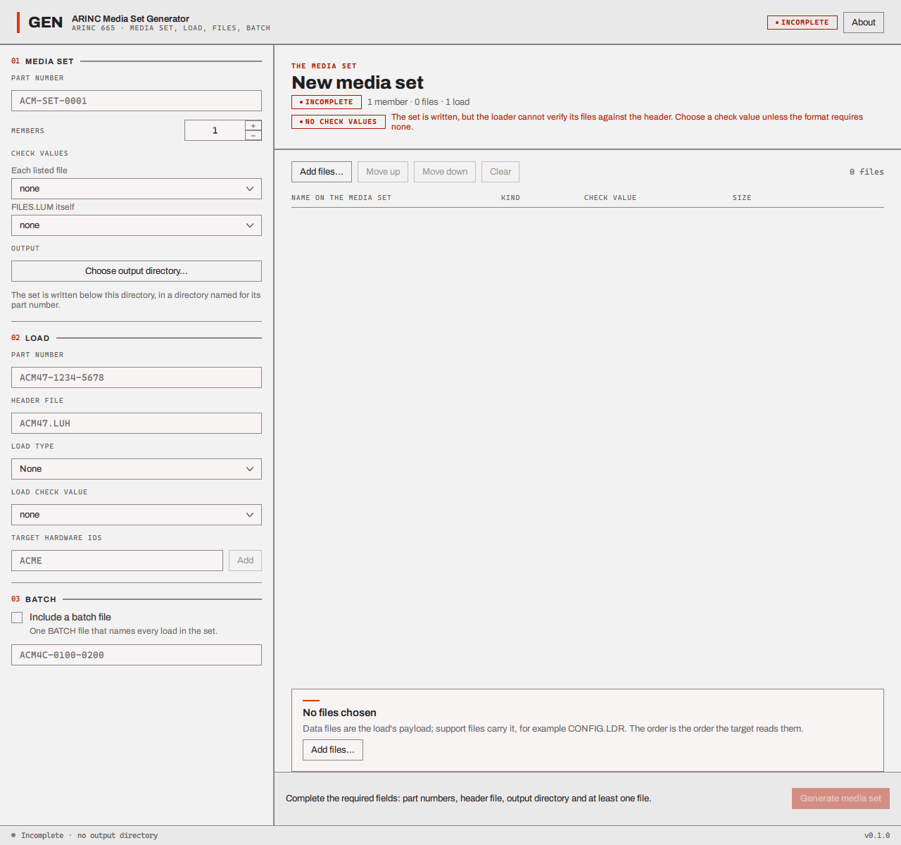
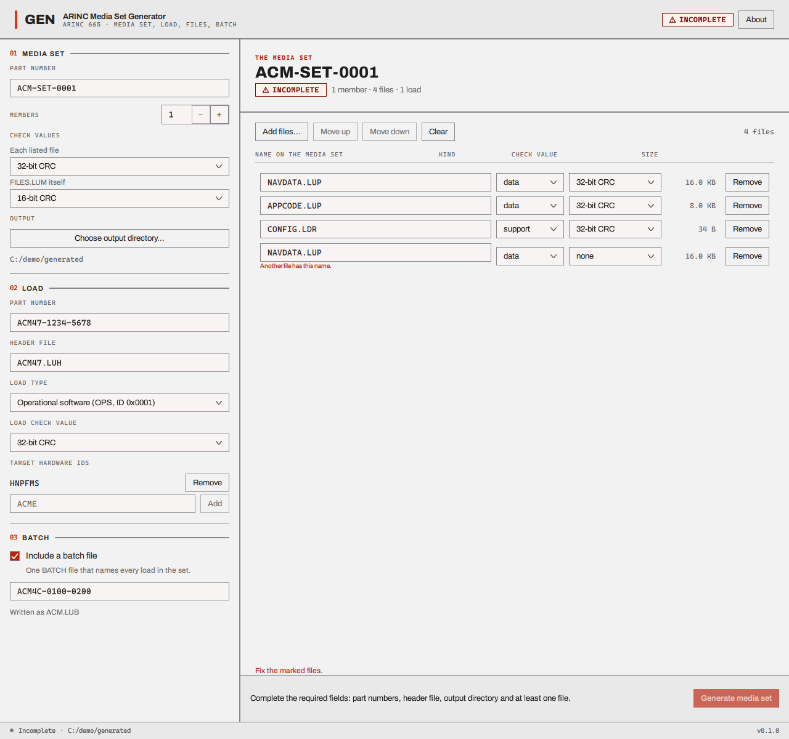
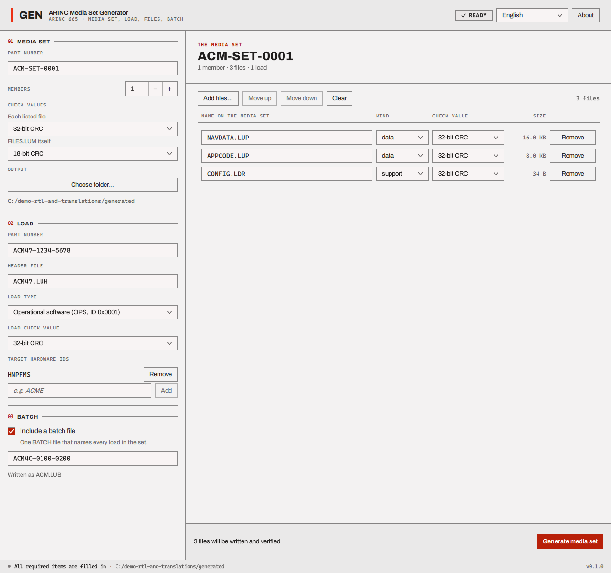
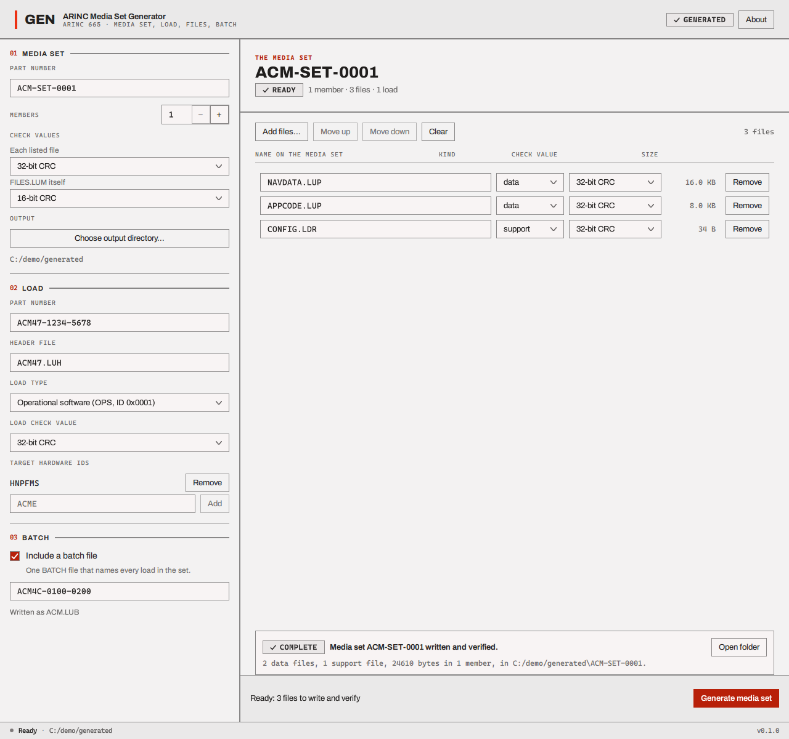
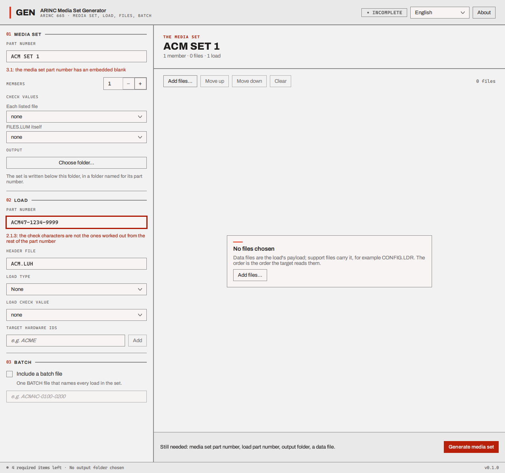

# Make a media set

The **ARINC Media Set Generator** turns files from your disk into a media set: it works out the
header file, the three list files and the check values, writes the folder tree the loader opens,
and then checks it by reading the tree back from disk. You decide the parts that are a person's
choice (names, part numbers, which check values), and it enforces the rest.



The window has a rail on the left with three numbered blocks to fill in, the table of files on the
right, and an action bar at the bottom. The button at the bottom right is always the main action:
**Generate media set**. While something needed is missing or wrong the bar says what, and pressing
the button then marks those fields instead of starting. The header chip says **NOT STARTED**
(nothing entered yet), **INCOMPLETE**, **READY**, **GENERATING**, and afterwards **GENERATED**,
**FAILED** or **CANCELLED**; none of the first three is an error, so none is red. A field shows
what is wrong with it once you have been in it, or all of them do once you press **Generate media
set** on an incomplete form.

## 01 Media set

| Field | What to enter |
| --- | --- |
| **Part number** | The media set's part number, for example `ACM-SET-0001`. Rules are [below](#media-set-part-number) |
| **Members** | How many members (disks) the set has, 1 to 255. One is right for a small load. With more, the data files are spread over the members, see [How the files are placed](#how-the-files-are-placed) |
| **Each listed file** | The check value kept in `FILES.LUM` for every file it lists: none, 8-bit CRC, 16-bit CRC, 32-bit CRC, MD5 or SHA-1 |
| **FILES.LUM itself** | The check value for the `FILES.LUM` list file itself, from the same choices |
| **Choose folder...** (under OUTPUT) | The folder in which the set is written. It must exist. The set goes into a new folder inside it named after the media set part number |

The demonstration uses **32-bit CRC** for each listed file and **16-bit CRC** for `FILES.LUM`.

## 02 Load

| Field | What to enter |
| --- | --- |
| **Part number** | The load's part number, for example `ACM47-1234-5678`. Rules are [below](#load-and-batch-part-numbers) |
| **Header file** | The header file's name. It follows the load part number (first three characters plus `.LUH`, so `ACM47.LUH`) until you type your own |
| **Load type** | *None*, or one of *Operational software* (OPS), *Navigation database* (NDB), *Aeronautical database* (ADB) or *Test software* (TST). The choice is written into the header file with its code |
| **Load check value** | The check value the header file carries for the whole load: none, 8-bit CRC, 16-bit CRC, 32-bit CRC, MD5 or SHA-1 |
| **Target hardware IDs** | The kinds of equipment the load is for. Type an identifier and press **Add**; **Remove** takes one away. The rules are [below](#target-hardware-ids) |

## 03 Batch

Tick **Include a batch file** to add one batch file that names the load for every target hardware
ID you listed. It needs its own part number (for example `ACM4C-0100-0200`). The batch file's name
is made from the first three characters of that part number and `.LUB`, and the window shows it
("Written as ACM.LUB"). Leave the box unticked if you do not need a batch. The loader reads and
counts batch files but does not use them; see [Limits](files-and-limits.md#limits).

## The files

**Add files...** opens a file chooser where you can pick several files at once. Each becomes a
row of the table, in the order they were added (**Move up** and **Move down** change the order of
the row you have clicked; **Clear** empties the table; **Remove** on a row takes that file out):

| Column | Meaning |
| --- | --- |
| **Name on the media set** | The file's name inside the set. It starts as the file's own name; you can edit it. It is checked as you type |
| **Kind** | **data** for the load's payload, **support** for files that accompany it, for example `CONFIG.LDR`. Every file starts as *data*; change the ones that are support files. A load needs at least one data file |
| **Check value** | The check value the *header file* records for this file |
| **Size** | The file's size (read-only) |

A row with a problem shows its reason under it, and **Generate media set** marks what is missing
until every row is right. The same name twice (in any capitals) is refused, because two files of
one name in one place cannot be told apart.



Once files are chosen, the chip **NO CHECK VALUES** appears when the three choices *Each listed file*, *FILES.LUM itself*
and *Load check value* are all *none* (it does not look at the **Check value** column of the
table). The set would be written without any of those check values. Every file is still listed
with a 16-bit CRC and the load carries a CRC of its own, and the loader checks those, but nothing
stronger is recorded. Choose a check value unless the format you are following requires none.



## Generate

Press **Generate media set**. The generator

1. reads every file (the progress bar counts the bytes read; a **Cancel** button is there while it
   does),
2. builds the load: the header file, with the check values,
3. builds the members and the three list files,
4. writes the tree to a temporary folder beside the output (named after the media set part number,
   with `.writing` added),
5. **reads the tree back from disk**, the way the loader does, and verifies every file and check
   value, and then
6. gives the folder its name, the media set part number (if that folder already holds anything, `_2`,
   `_3` and so on is added instead, so nothing is ever overwritten).

When it ends, the header chip says **GENERATED** and a banner above the action bar says "Media set
... written and verified.", with the numbers of data and support files, the bytes, the members and
the folder, and an **Open folder** button. If the read-back finds anything that differs from what
the standard *recommends* (but can still be read), the banner adds how many differences there are
("1 difference from the standard's recommendations."); they do not stop the set being used. The
generator does not list them: choose the set in the loader, which lists them as warnings. If
something is wrong the chip says **FAILED** and the banner says why; after a **Cancel** it says
**CANCELLED**. Whatever fails, and a **Cancel** at any point, leaves no half-written set: the
temporary folder is removed and the banner says so (if it cannot be removed, the banner says where
it is). A set only ever appears under its own name whole and verified. If you change anything in
the window afterwards (a field, or the files), the banner and the **Open folder** button go away and
the chip goes back to **READY** or **INCOMPLETE**.



The folder you give to the loader's **Choose** button is the one the banner names, for example
`.../generated/ACM-SET-0001`.

## How the files are placed

For a set of one member (the usual case) the member folder holds `LOADS.LUM` and `FILES.LUM`, and
one folder named after the load's part number without its hyphens (`ACM4712345678`), which holds
the header file, the data files and the support files. With a batch file, the member folder also
holds `BATCHES.LUM` and the batch file itself (`ACM.LUB` here), beside the other two list files:

```text
ACM-SET-0001/
  member_001/
    LOADS.LUM
    FILES.LUM
    BATCHES.LUM         (only with a batch file)
    ACM.LUB             (only with a batch file)
    ACM4712345678/
      ACM47.LUH
      NAVDATA.LUP
      APPCODE.LUP
      CONFIG.LDR
```

With more than one member, every member has its own `LOADS.LUM` and `FILES.LUM` (and
`BATCHES.LUM` with a batch file). The header file, the support files and the batch file stay on
member 1, in the same places as above. The data files are dealt out round-robin: the first to
member 1, the second to member 2, and so on, and each goes into a second folder of the same name
inside the load's folder, on every member, member 1 included. For two members and the three files
above:

```text
ACM-SET-0001/
  member_001/
    LOADS.LUM
    FILES.LUM
    ACM4712345678/
      ACM47.LUH
      CONFIG.LDR
      ACM4712345678/
        NAVDATA.LUP
  member_002/
    LOADS.LUM
    FILES.LUM
    ACM4712345678/
      ACM4712345678/
        APPCODE.LUP
```

## The rules the generator enforces

The generator uses the same checks the loader uses to judge a set, so a form with no red text
makes a set the loader accepts, except for the file-name rule that the form does not check (see [File names](#file-names)). The read-back may still find differences from the standard's
recommendations (an odd-sized data file, for example); the loader shows those as warnings and they
do not stop an upload. Most rules are from ARINC 665-3; the section is in brackets.

### Media set part number

A media set part number (3.1) is at most 15 characters, has no blanks, does not end in a hyphen,
and contains none of the letters `I`, `Q` and `Z` (the standard recommends against them).

### Load and batch part numbers

A load part number (2.1.1, 2.1.3), also used for batches, has the form `MMMCC-SSSS-SSSS`: 15
characters with a hyphen after the fifth and the tenth.

- `MMM` is the manufacturer's code: three upper-case letters or digits.
- `CC` are two **check characters**, two upper-case hexadecimal digits that must be the right ones
  for the rest of the number: the exclusive-or of the ASCII codes of the manufacturer's code and
  the product identifier (hyphens left out), shown as two hexadecimal digits. For `ACM` and
  `1234-5678` they are `47`, giving `ACM47-1234-5678`. If you type the wrong ones the window
  says so.
- `SSSS-SSSS` is the product identifier: upper-case letters and digits, without `I`, `O`, `Q` or
  `Z`.



### File names

All names (2.2.2): at most 255 characters, no blank or control character and nothing outside
printable ASCII, none of the characters `~ / : \`, and not `.` or `..`. On top of that:

| Name of | Extra rule |
| --- | --- |
| The header file | Ends in `.LUH`, and begins with a manufacturer's code (three upper-case letters or digits) |
| A data file | Must not use one of the extensions the standard keeps for itself, except `.LUP`, the recommended one |
| A support file | The same, but `.LDR` and `.HDR` are allowed, because `CONFIG.LDR` and a Boeing header file are support files |
| The batch file | Ends in `.LUB` (the window makes it for you) |

The reserved extensions are `CRC`, `DIR`, `HDR`, `LDR`, `LCI`, `LCL`, `LCS`, `LNA`, `LND`, `LNL`,
`LNO`, `LNR`, `LNS`, `LUB`, `LUH`, `LUI`, `LUM`, `LUP`, `LUR` and `LUS`. A data file called `REPORT.LUM`, for example, is refused.

The form checks names against ARINC 665 only. The set is then written as a folder tree that has to be usable on every system, and that rule is stricter: a name that holds one of `* ? " < > |`, that ends in a dot or a space, or that is a device name (`CON`, `NUL`, `COM1` and so on) passes the form and then makes the generation fail. The chip says **FAILED** and the banner names the file. Use plain names.

### Target hardware IDs

A target hardware ID (1.5) is 4 to 15 characters long and either four hexadecimal characters (an
ARINC 429 equipment code such as `2A4F`) or begins with a manufacturer's code (three upper-case
letters or digits, as in `HNPFMS`).

### Pathnames inside the set

You do not type these, but the generator and the loader check them: a file's pathname starts at
the root of the member with a backslash and ends with one, has no empty directory name, and is at
most four directories deep.

## What the generator does not do

- It writes one load per media set. A set with several loads, or a load spread over members in
  another pattern, is not made by this window (the library underneath can; the window does not
  offer it yet).
- It reads each file completely into memory, so the files are limited by the computer's memory.
- It does not change files you give it, and it never writes over anything.

## The About box

**About** shows the version, the build it came from, the licence and a **Licences** button that
lists the third-party components inside the program.

Next: [run the mock target](mock-target.md), or go straight to [the demonstration](demonstration.md).
