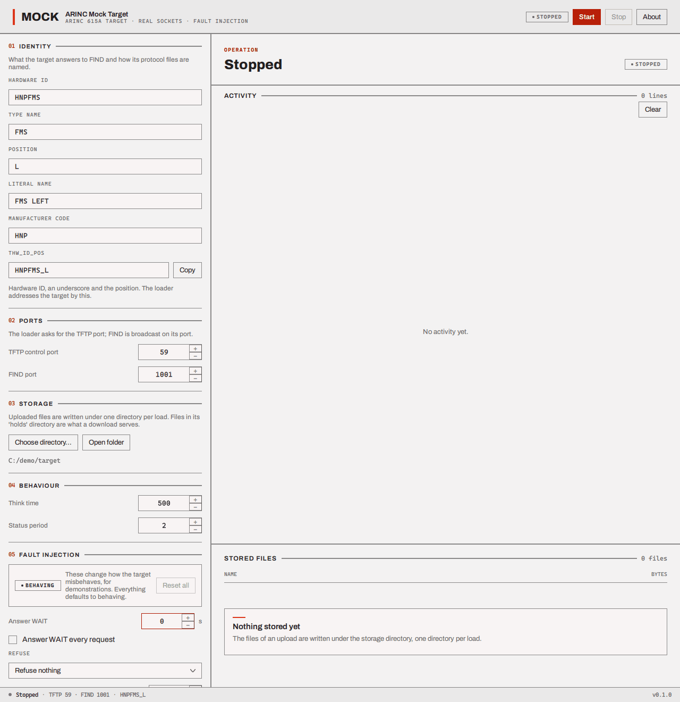
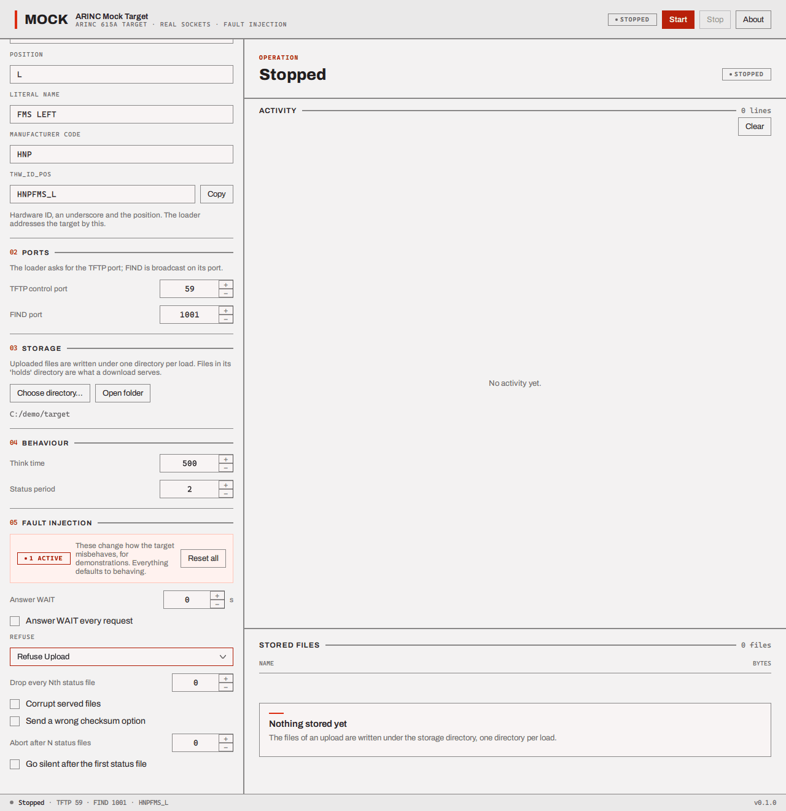
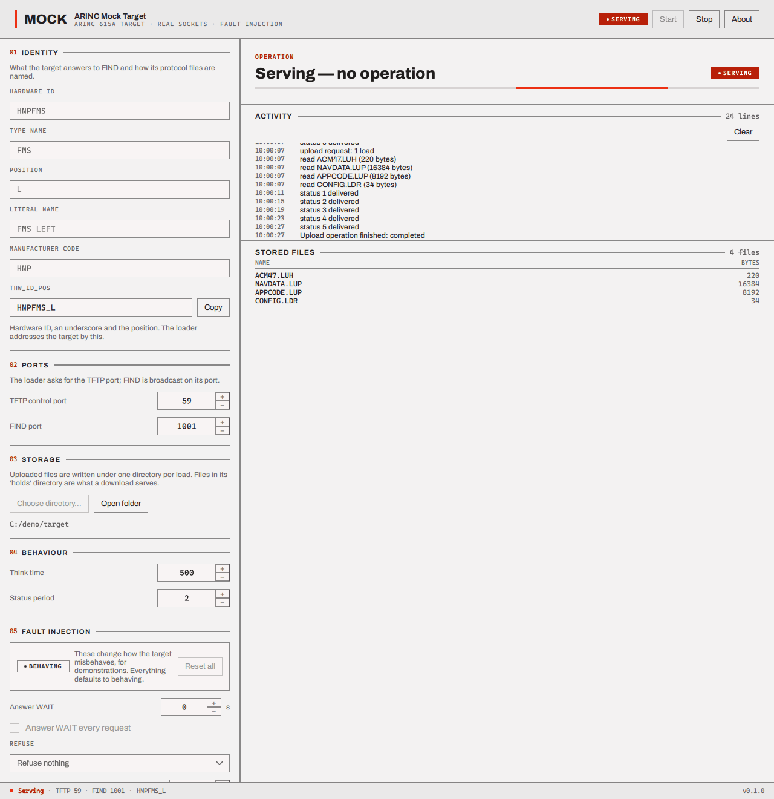

# Run the mock target

The **ARINC Mock Target** behaves like a piece of equipment that follows ARINC 615A, over real
network sockets, so you can use the loader without any hardware. It answers FIND, serves the
Information, Upload and Download dialogues, keeps what an upload sends it, and can be told to
misbehave on purpose so that you can watch the loader cope. It is **for practice, demonstrations
and testing. It is not a real target**: it does not load anything into anything.

The window has the settings on the left, numbered, and on the right what the target is doing:
the current operation, its activity log and the files it has stored. The header chip says
**STOPPED** or **SERVING**, and **Start** and **Stop** are the two buttons next to it. Every
setting is dimmed while the target is serving: stop it, change what you want, start it again.

## 01 Identity

What the target answers when a loader asks FIND, and how it is addressed.

| Field | Default | Meaning |
| --- | --- | --- |
| **Hardware ID** | `HNPFMS` | The target's hardware identifier. Required: **Start** is dimmed without it |
| **Type name** | `FMS` | The kind of equipment |
| **Position** | `L` | Where it is fitted (left, right ...). May be empty |
| **Literal name** | `FMS LEFT` | A readable name |
| **Manufacturer code** | `HNP` | The manufacturer's code |
| **THW_ID_POS** | (shown) | The hardware ID, an underscore and the position, here `HNPFMS_L`. This is what you type into the loader to address the target. **Copy** puts it on the clipboard |

## 02 Ports

| Field | Default | Meaning |
| --- | --- | --- |
| **TFTP control port** | 59 | The port the loader's requests go to. The standard says 59. The loader asks the target to use a port of its own for the files it serves, so the two can share a machine as long as the loader's control port (in its [Preferences](preferences.md)) is not also 59 |
| **FIND port** | 1001 | The port FIND requests arrive on |

Both must be between 1 and 65535. On Linux and macOS, ports below 1024 may need extra privilege.

## 03 Storage

**Choose directory...** names a folder where the target keeps what an upload sends it, and where
the files it can give in a download are taken from. **Open folder** opens it.

- An **upload** is stored in `<storage>/<load part number>/<file name>`: one folder per load, with
  the header file, the data files and the support files as the target read them.
- A **download** serves the files in `<storage>/holds`. The list of files is read **once, when you
  press Start**; a file you put there while the target is serving is not offered until you stop and
  start again. With no storage folder, or an empty `holds`, the target holds one file,
  `DEMO.TXT`.
- With no storage folder the target still works, but an upload is not kept. The window says so
  ("No storage directory chosen. The target still serves; an upload is not kept.").

## 04 Behaviour

| Field | Default | Meaning |
| --- | --- | --- |
| **Think time** | 1000 ms (0 to 60 000) | How long the target takes to answer a request, as a slow piece of equipment would |
| **Status period** | 4 s (0 to 3600) | How often the target writes a status file while it works. A shorter period makes a demonstration faster |

## 05 Fault injection

Everything here defaults to *behaving*. The block's chip says **BEHAVING** or **N ACTIVE**, and
**Reset all** puts every fault back, so a demonstration cannot quietly run with a fault left on.
The faults are for seeing what the loader does when the target is not well behaved.

| Fault | What the target does | What you should see in the loader |
| --- | --- | --- |
| **Answer WAIT** (seconds) | Answers the loader's first request with WAIT for that many seconds (the standard's way to say "not yet") | The log notes that the target asked to wait; the operation starts later |
| **Answer WAIT every request** | Does that for every request | The loader waits each time |
| **Refuse** | Refuses the chosen operation (*Information*, *Upload*, *Download (media defined)*, *Download (operator defined)*) with "operation denied" | The operation ends **FAILED**, the outcome is "denied by the target", and a dialog opens |
| **Drop every Nth status file** | Does not send every Nth status file | The log reports status files lost |
| **Corrupt served files** | Flips a bit in every file it serves, **protocol files included** | A download usually ends at once, **FAILED**, with "unsupported protocol version" (the damaged protocol file), before any data file is requested |
| **Send a wrong checksum option** | Attaches a wrong check value to the files it serves | The log shows `checksum did not match: <file>` in red, the file is still received and kept, and the operation **completes**: the mismatch is a warning, so read the log |
| **Abort after N status files** | Stops on its own after N status files, saying it aborted | The outcome is "aborted by the target" |
| **Go silent after the first status file** | Stops answering at all | The loader waits for its 13 second time-out, then reports "data load protocol time-out" |

## The right-hand side

- **Operation** shows what the target is doing (Information, Upload, Download or *Serving, no
  operation*) and, for an operation that has progress, the percentage "of the target's list".
- **Activity** lists every status file, file read or written, WAIT and abort, each with its time
  and a colour for its seriousness. **Clear** empties it.
- **Stored files** lists the files an upload left, with their sizes.

## Stopping

**Stop** ends the session at once. If an operation was running the loader will notice that the
target went quiet and report it (see [Troubleshooting](troubleshooting.md#the-target-does-not-answer)).

Next: [the loader](loader.md).
