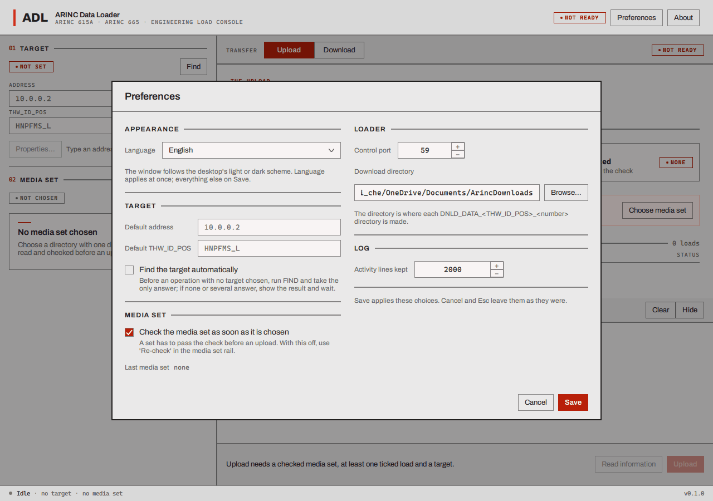
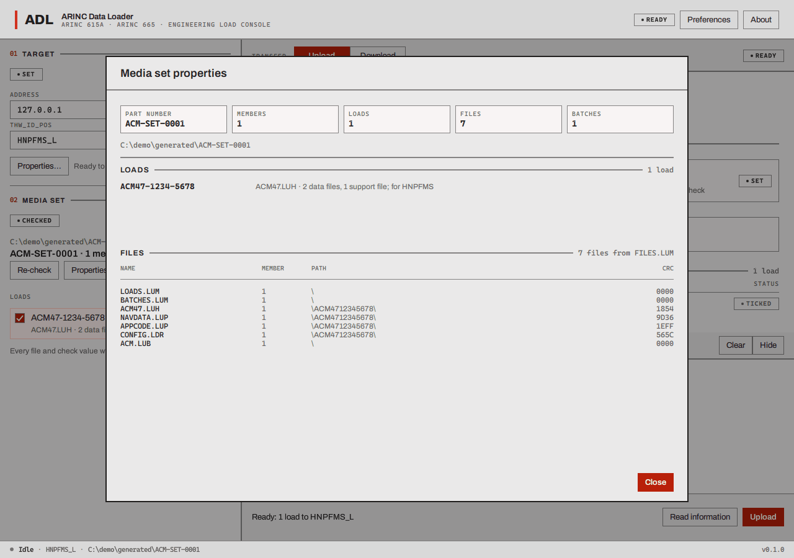
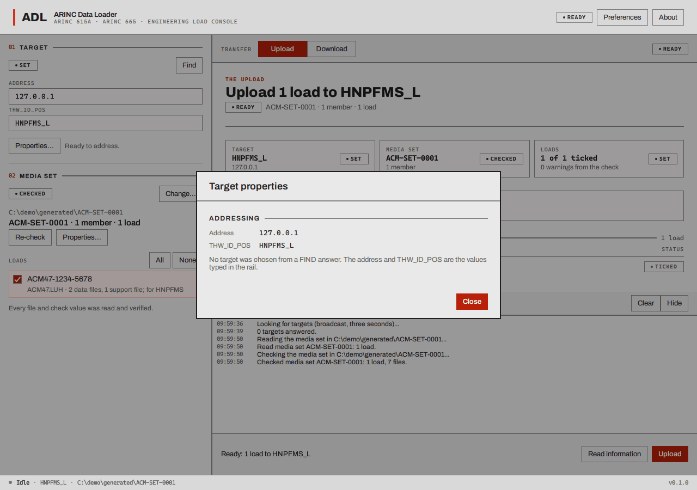
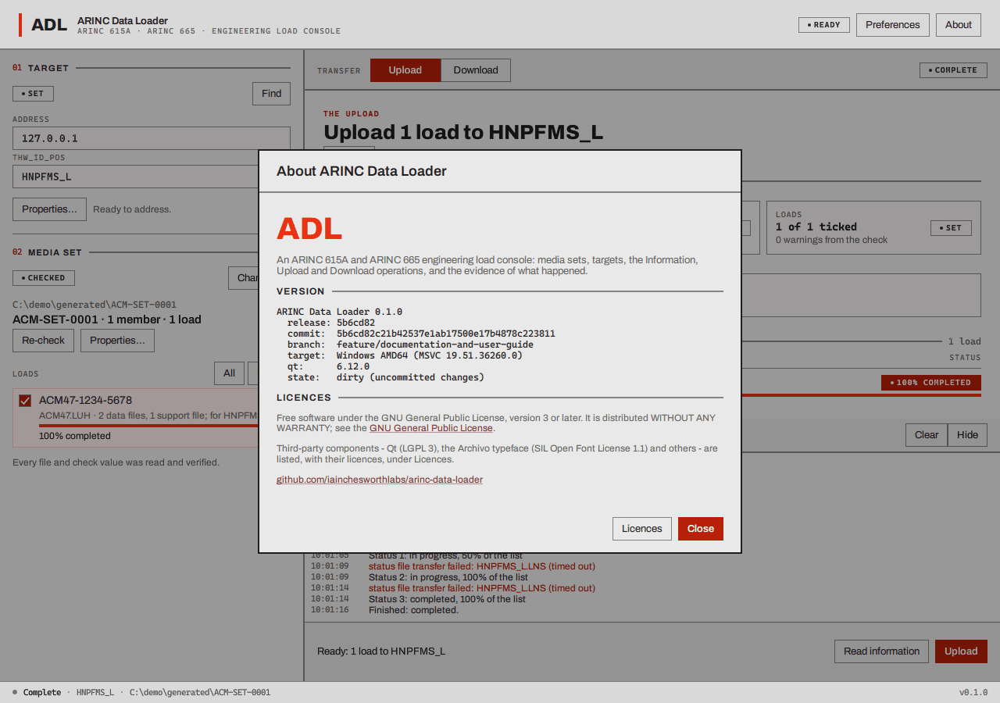
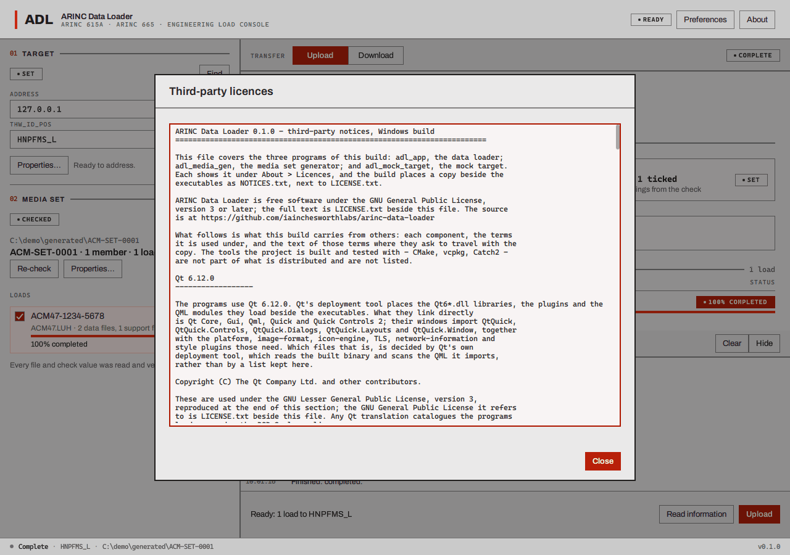

# Preferences and the other dialogs

## Preferences

**Preferences** (the button at the top right of the loader) opens a page of choices in two
columns. The loader keeps them between runs. **Save** writes your changes and closes the page;
**Cancel**, and the Esc key, leave everything as it was. (The language is the one exception: it
changes at once, see [Languages and colour](languages-and-colour.md).)

| Setting | Default | What it does |
| --- | --- | --- |
| **Language** | the system's, if there is a translation, otherwise English | The language of the window. See [Languages and colour](languages-and-colour.md) |
| **Default address** | empty | The IPv4 address filled into the **Address** field of the workbench when the loader starts, and again whenever you clear that field |
| **Default THW_ID_POS** | empty | The same for the target identifier (for example `HNPFMS_L`) |
| **Find the target automatically** | off | When you press **Read information**, **Upload** or **Download** with no target chosen, the loader runs FIND first. If exactly one target answers it is taken and the operation goes on; if none or several answer, the result is shown and the loader waits for you to choose |
| **Check the media set as soon as it is chosen** | on | A media set has to pass the check before an upload. With this off, press **Re-check** in the media set block |
| **Last media set** | (shown, read-only) | The folder chosen last time. It is opened again quietly when the loader starts |
| **Control port** | 59 | The UDP port the loader answers the target on during an operation (1 to 65535). The standard says 59. **If the target runs on the same computer as the loader, change it**, for example to 5900, because the target already uses 59. Any value but 59 is sent to the target as an option in the request, so a target that follows the standard moves its file traffic to that port |
| **Download directory** | `Documents/ArincDownloads` | The folder in which each download makes its own `DNLD_DATA_<THW_ID_POS>_<number>` folder. **Browse...** chooses it. It is made if it does not exist |
| **Activity lines kept** | 2000 | How many lines the [activity log](log-and-receipt.md#the-activity-log) keeps (100 to 1 000 000). The oldest go first |

The loader also remembers, without asking, the **last target** an operation was started against
and puts it back in the Address and `THW_ID_POS` fields the next time it starts, and its window
size and position.

## Media set properties

**Properties...** in the media set block opens a page with everything the loader learnt when it
read the set:

- the **part number**, the number of **members**, **loads**, **files** and **batches**;
- the folder it was read from;
- every **load** with its header file and the numbers of its data and support files, and the
  target hardware IDs it is for;
- every file listed in `FILES.LUM`: its **name**, the **member** it is on, its **path** inside the
  member, and its **CRC**;
- and the **warnings**: the places the set differs from what the standard recommends. They are
  shown, and they do not stop an upload.

## Target properties

**Properties...** in the target block shows what the loader knows about the target: the address and
`THW_ID_POS` that are set, and, if the target was chosen from a FIND answer, everything it said:
the address, hardware identifier, type, position, name and manufacturer code. If you typed the
target by hand, the page says that no FIND answer was used.

## About, and the licences

**About** shows what the window is for, the version and the build it came from (release,
commit, branch, target and Qt version, and a note if the build had uncommitted changes), the
licence, and the repository address. The software is free software under the GNU General Public
License, version 3 or later, and comes with **no warranty**.

**Licences** lists the third-party components inside the program, each with its licence: Qt (under
the LGPL, with the offer of its source), the Archivo typeface (SIL Open Font License) and the
other runtime files that ship with it.

The generator and the mock target have the same About box.

## Dialogs that ask or tell

- **An operation is running.** Closing the window while a job runs asks first: **Keep working** or
  **Stop and close**. The second asks the target to stop and waits for it to confirm, which can
  take up to 13 seconds; the window stays open until then.
- **The operation failed.** Every failed operation opens one dialog with what happened, the detail,
  and, where the loader knows one, what you can do about it. See
  [The log, the receipt and failures](log-and-receipt.md#failures).
- **Choose a directory** (the media set, the download directory) is the system's own folder
  chooser.
