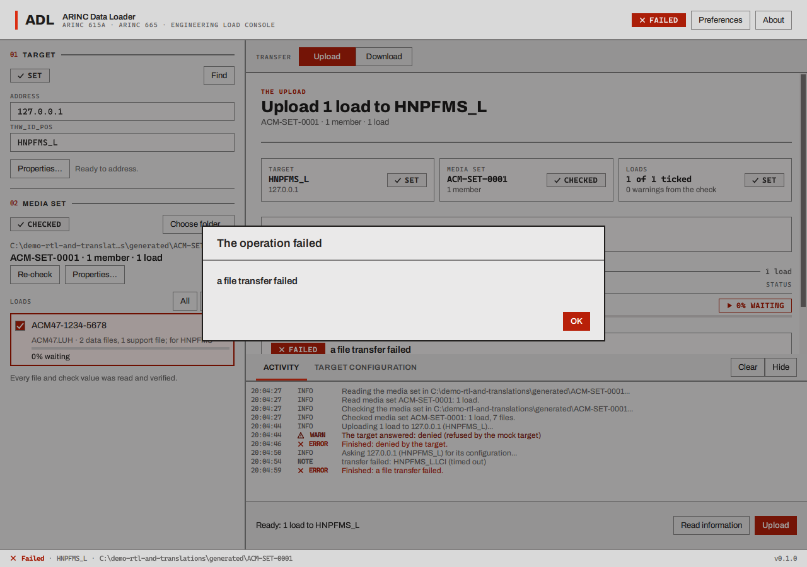
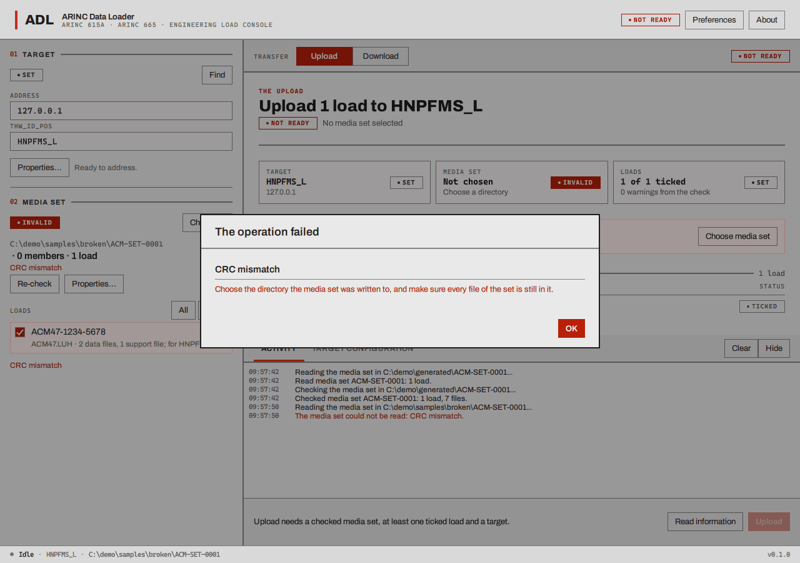
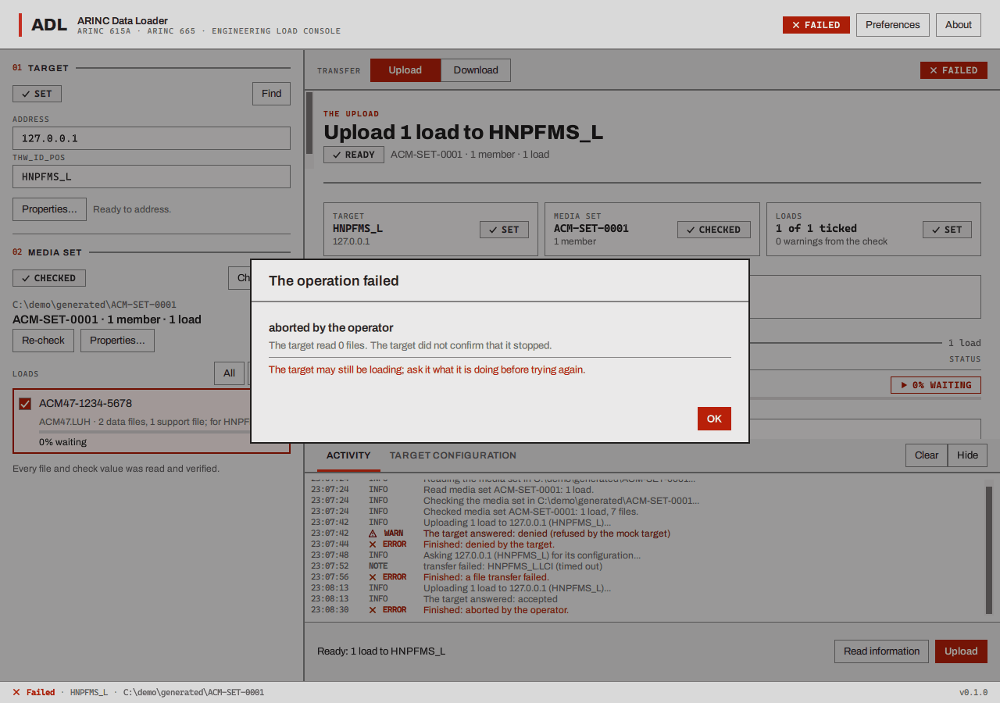

# Troubleshooting

Most problems announce themselves in the [activity log](log-and-receipt.md#the-activity-log) and in
the dialog that opens when an operation fails. This page lists what the programs show and what to
check, starting with the most common.

## The target does not answer

The loader asks for the target's initialization file and waits two seconds for each packet,
trying once more. If nothing comes back it gives up after about eight seconds. The log says
`transfer failed: HNPFMS_L.LCI (timed out)` and `Finished: a file transfer failed.`, and the
dialog says **a file transfer failed** with no hint.

Check, in this order:

1. **Is the target running?** (In the demonstration: is the mock target *SERVING*?)
2. **Is the address right?** Four numbers with dots. `127.0.0.1` means *this computer*; it is only
   right when the target runs on the same machine. The loader does not check that anything is at the
   address before it asks.
3. **Is `THW_ID_POS` right?** The loader asks for files named after it (`HNPFMS_L.LCI`); the mock
   target's own `THW_ID_POS` is shown in its window and can be copied.
4. **Can the two computers talk?** Try the address with `ping`. A firewall on the loader's computer
   or the target's may be blocking UDP port **59**, the target's control port, and, during an upload or
   download, the loader's own control port (the target comes back to it): see
   [Installing](installing.md#what-the-firewall-asks).
5. **Is the target on port 59?** The loader always sends its request to port 59 of the target's
   address. A target that listens somewhere else cannot be reached by this version. (The
   *control port* in Preferences is the loader's own port, not the target's.)
6. **Did the operation start and then go quiet?** A target that stops writing status files makes the
   loader wait 13 seconds and report **data load protocol time-out**. The mock target does this on purpose
   if you tick *Go silent after the first status file*.

## FIND finds nothing

"0 targets answered" means no answer reached the loader within three seconds. FIND is a broadcast
on the local network:

- It **does not reach a target on the same computer**. That is expected in the demonstration: type the
  address by hand.
- It **does not cross routers**, and some networks (AFDX among them) have no broadcast at all. Type
  the address by hand.
- A **firewall** on the loader's computer can drop the answer (UDP port 1001), and one on the
  target's computer can drop the request. A computer with several network adapters may send the
  broadcast out of the wrong one.
- The target must listen on port 1001. The mock target's *FIND port* is that.

Typing the address and `THW_ID_POS` always works if the target can be reached.

## A port is in use, or not allowed

The loader's dialog says "The loader could not use the network or its port. Check that no other
copy of the loader is running, and that no other program holds the control port (Preferences)."

- **The target is on the same computer.** Two programs cannot both own UDP port 59. Set the loader's
  **Control port** to another number such as 5900 (Preferences). The loader tells the target, which
  moves its file traffic to that port.
- **Another copy of the loader is running**, or an earlier one has not finished closing.
- **The mock target will not start** ("The TFTP and FIND ports must each be between 1 and 65535", or
  its log shows `the FIND port could not be bound: port 1001: ...`): something else uses 59 or 1001,
  or, with *permission denied*, a port below 1024 needs extra privilege on Linux and macOS (and a
  port the system has reserved on Windows). On Linux give the program `CAP_NET_BIND_SERVICE` or lower
  `net.ipv4.ip_unprivileged_port_start`; see [Installing](installing.md#linux).
- **The loader fails at the start of every operation on Linux** ("the loader's port could not be
  opened (permission denied)"): its default control port is 59, which is below 1024. Set the
  *Control port* in Preferences to 5900, or give `adl_app` the capability as above.
- **A Windows or macOS firewall window is in front of everything**, or an automated run stopped
  there: see [Installing](installing.md#what-the-firewall-asks). For the demonstration tick *This
  computer only (127.0.0.1)* in the mock target, which listens on no network and so is not asked
  about; for a target on the network, run `tools/network-access/windows/adl_firewall.ps1` once.
- **The loader always sends to port 59 of the target.** Moving the mock target to another TFTP port
  makes it unreachable from the loader. In a demonstration keep the mock target on 59 and move the
  *loader's* control port.

## The media set will not open, or says INVALID

- **"Choose a directory with one directory per member."** Pick the folder that *contains*
  `member_001`, not `member_001` itself and not a folder above the set.
- **INVALID** with a reason: the loader read the set and found a file that is missing, a file whose
  length or check value is wrong, or a list file that disagrees with the files. The reason is in the
  rail and the Upload view. The set cannot be uploaded. Rebuild it with the generator, or restore the
  damaged file.

- **Warnings** do not block: they say where the set departs from the standard's recommendations.
- **A file changed after the check** is not noticed until you press **Re-check**.

## An upload or download that "completed" but failed

- **"completed, 1 load failed"**: the target accepted the operation, then gave up on a load. The log
  line "The target failed load ... (<header file>): <reason>" says why, in the target's words.
- **"completed, 1 file missing"** (download): you asked for a file the target did not send. Check the
  name against what the target can give ([operator defined mode](download.md#operator-defined-the-target-lists-you-pick)
  shows its list), and the log.
- **A refusal** ("denied by the target"): the target will not do the operation now (it may be busy
  with another, or not allow it). The log has its reason after "The target answered: denied".

## Check values

- `checksum did not match` in the log: a file that arrived does not match the check value the target
  sent with it. **The loader keeps the file and the operation still completes**, so this line is the
  only warning: do not trust that file. (The mock target does this on purpose with *Send a wrong
  checksum option*; *Corrupt served files* damages the protocol files too and ends the operation with
  "unsupported protocol version".)
- A generated set whose chip says **NO CHECK VALUES** can be loaded, but the loader cannot verify its files:
  choose check values in the generator and generate again.
- A part number the generator refuses because of its check characters: see
  [the rules](make-a-media-set.md#load-and-batch-part-numbers).

## Status file transfer failed (timed out) with the mock target

With the mock target, the loader's log shows, after **every** status file the target writes,
`status file transfer failed: HNPFMS_L.LUS (timed out)` (or `.LCS`, `.LNS`), usually followed by the
status line itself. The status counter keeps counting up and the operation finishes **completed**,
so the status files are being received and used; what is flagged is the end of each transfer. This
has been seen with the mock target only (never with a real target, which has not been tried), and is
recorded as an open question in the project notes. "status files lost (n)" lines also turn up now and
then with the mock target: some status files do not arrive, and the next one that does is used. If you
see them with a *real* target, treat them as real losses on the network.

## An abort that is not confirmed

**Abort** tells the target to stop and waits for it to say it has. If the target does not (it is
silent, or has already gone), the loader ends the operation after its 13 second time-out and says "The
target did not confirm that it stopped" with the hint "The target may still be loading; ask it what it is
doing before trying again."

## The windows

- **The window opens on the first-run screen again.** Its settings were cleared. They are
  [stored per user](files-and-limits.md#where-files-go).
- **The colours are the wrong way round.** The programs follow the desktop's setting, see
  [Languages and colour](languages-and-colour.md#colour).
- **The text is in another language.** Preferences > Language. The loader starts in the system's language when it
  has a translation for it.
- **A button is dimmed.** The action bar or the banner above it says what is missing
  ("Upload needs a checked media set, at least one ticked load and a target.").
- **The window is too big for the screen.** The loader is at least 1000 by 620 pixels; on a smaller screen its
  size is limited to the screen and its rail and pages scroll (a scroll bar shows when they do).
  The activity dock starts folded in a short window: press **Show** to open it.

## Building and running (developers)

- On Windows a **Debug** build cannot open the system file dialogs: AddressSanitizer reports an error
  inside Windows and the program exits with status 1 when you press "Choose...". Build and use
  `windows-msvc-release` ([Building](../building.md#presets)).
- A Windows firewall prompt for an unfamiliar program path appears the first time it opens a port on
  the network. It is answered by the person at the keyboard and stops automated runs of the
  programs; run `tools/network-access/windows/adl_firewall.ps1` as administrator for each build
  folder, or bind loopback only (the mock target's *This computer only*, and `127.0.0.1` as the target,
  as the test suite does), see [Installing](installing.md#what-the-firewall-asks).

If none of this helps, the log text and the dialog are what a bug report needs, with the version
(About) and the operating system.
